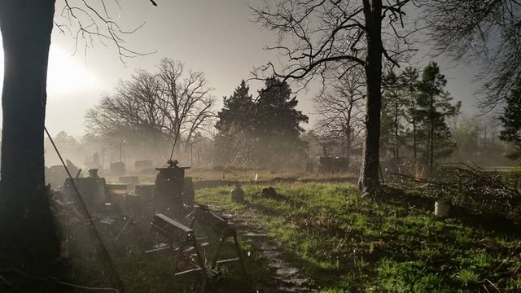
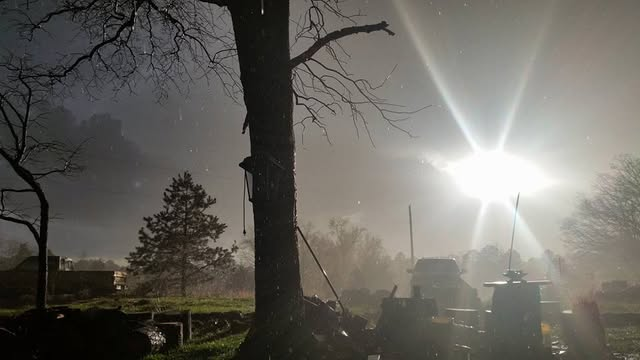
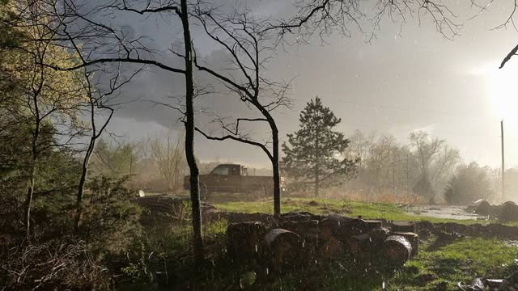
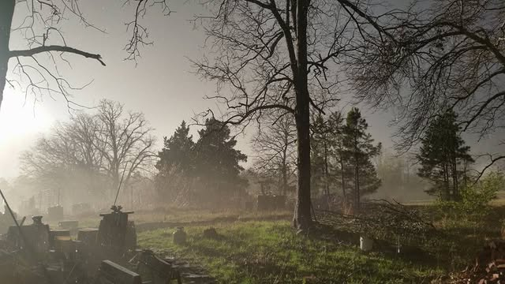
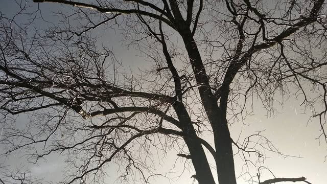
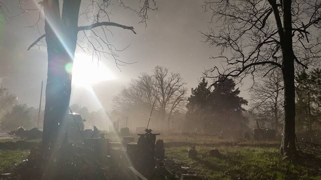
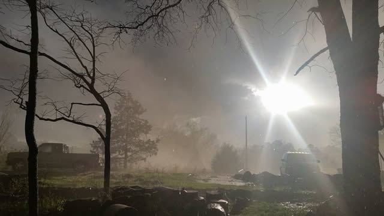
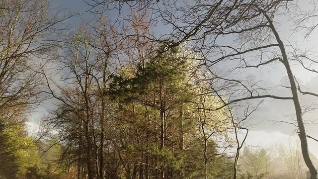

# So, there is a tornado watch at the moment.  The temperature dropped about 20 de

So, there is a tornado watch at the moment.  The temperature dropped about 20 degrees and it got really dark.  Then the hail started falling and it began raining really hard.  My little dome is shaking from all the wind and I hear branches hitting the dome.  Then in the middle of all this it gets really bright outside.  I guess for a few minutes there was a break in the clouds in just the right spot.  So I went out and stood in the rain to take these somewhat surreal photos.

