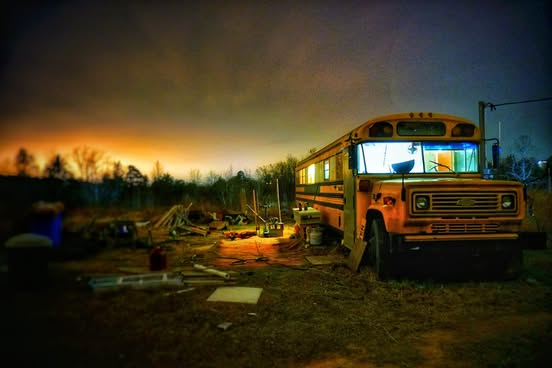

# "Greg of the Apocalypse"  Greg is this 40ft bus that my friend Chance Snyder is 

"Greg of the Apocalypse"  Greg is this 40ft bus that my friend Chance Snyder is turning into a camper in my yard.

So after selling 19 calendars and making $150, I went ahead and bought an $800 "real camera".  This photo was from playing around with a 30 second exposure basically in the dark on a rainy evening.  The glow in the background is the light from the nuclear plant about 10 miles away.

Thanks again to whoever bought those calendars.

*Location: Dover, Arkansas*

