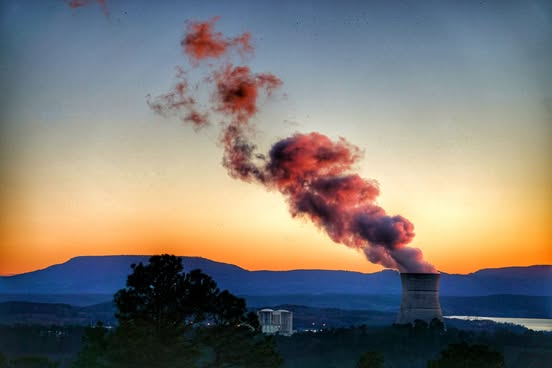

# At this place mortal man commands the earth to destroy itself for our amusement.

At this place mortal man commands the earth to destroy itself for our amusement.  The fundamental substance of physical reality is being utterly annihilated.  Matter that witnessed the birth of the  universe,  ripped forcibly apart with unimaginable violence.  The lake bares witness and so is vaporized and spewed into the sky.   Massive turbines are compelled into motion spinning enslaved electrons at the speed of light across the globe and to distant stars.  The darkness is held at bay.

In other words, just another Friday morning in Russellville.

*Location: Russellville, Arkansas*

