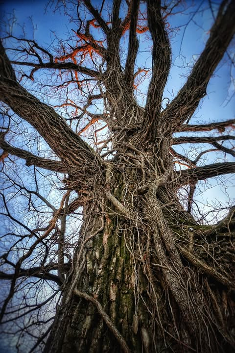

# Parasites bind them to the earth, as they crumble to dust reaching towards the s

Parasites bind them to the earth, as they crumble to dust reaching towards the sky.

*Location: Holla Bend National Wildlife Refuge*

