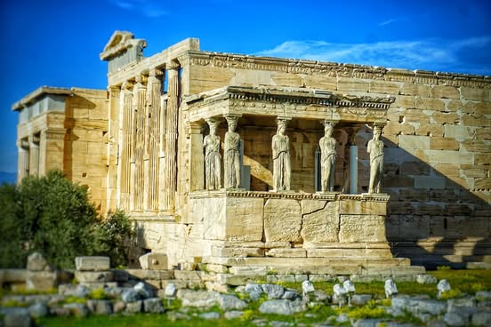
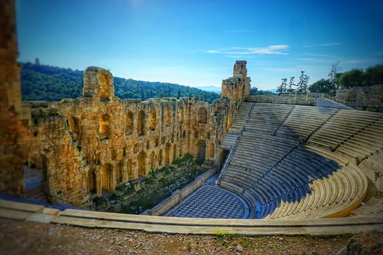

# The 2500 year old famous stuff that was on the hill from yesterday.  Parthenon, 

The 2500 year old famous stuff that was on the hill from yesterday.  Parthenon, temple of Zeus, Hadrian's arch.

