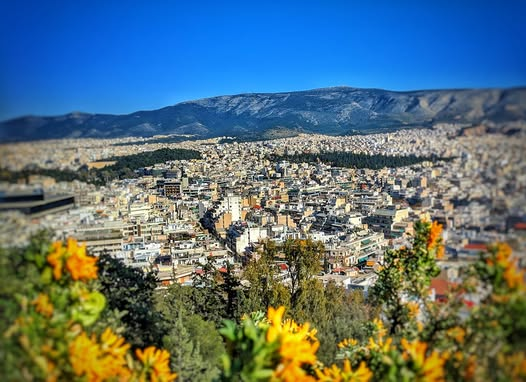

# In the top center of this picture is the hill I climbed my first day here.  The 

In the top center of this picture is the hill I climbed my first day here.  The little one below that mountain. I asked a local what it was called and he explained that it was difficult to translate.  Apparently it is something like "the killing hill" or "the dying hill" or "the hill of slaughter".  

During the war this is where the Germans executed their Greek prisoners and buried them in mass graves.  It is unmarked today and covered in flowers.  But I guess everyone knows what it is.

*Location: Athens, Greece*

