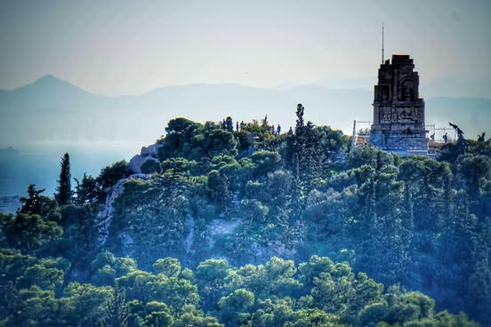
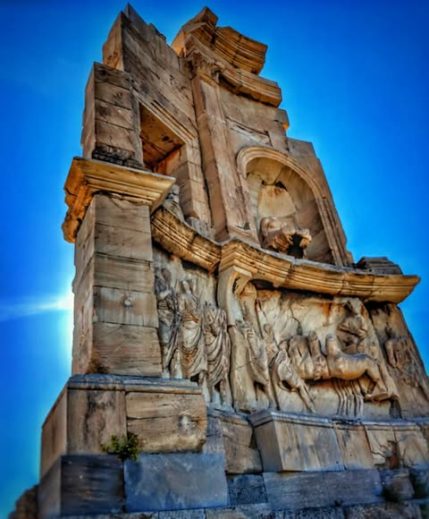
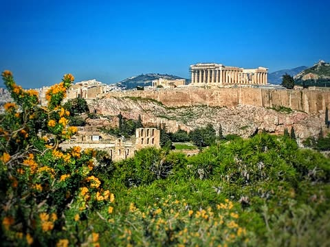
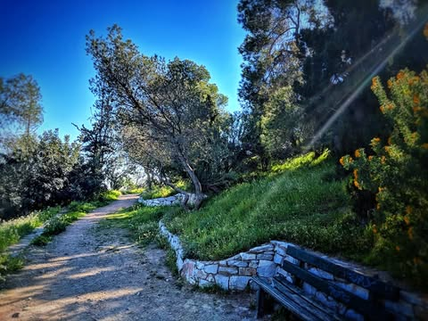
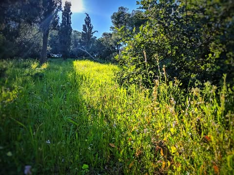
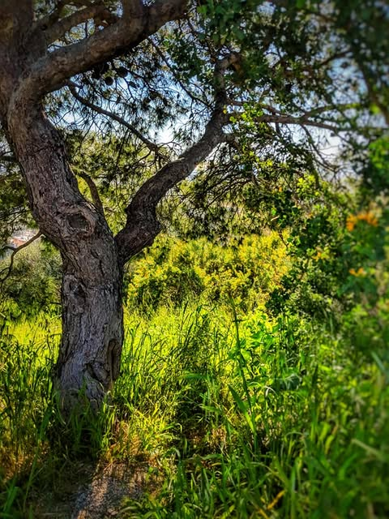
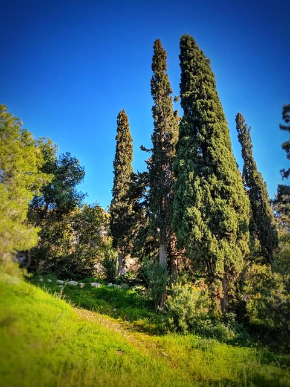
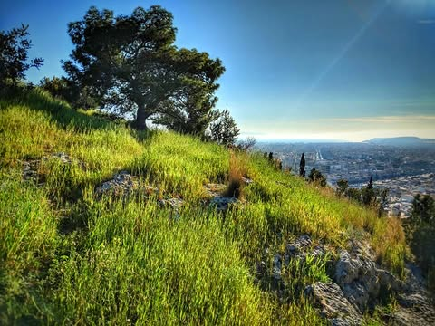
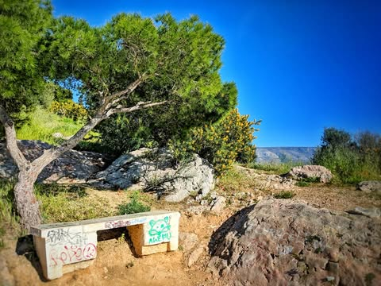
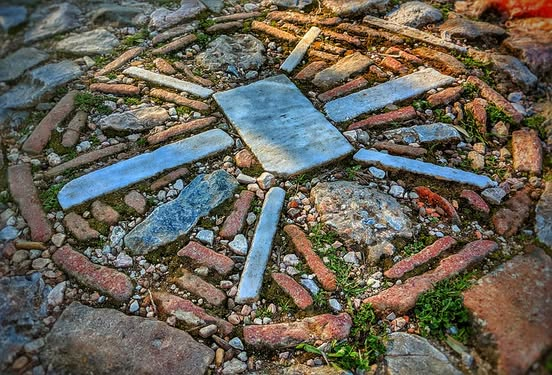

# So, this is Filopappou Hill.  That first picture is from the Acropolis, the rest

So, this is Filopappou Hill.  That first picture is from the Acropolis, the rest are on the hill.  I could not figure out what the weird whatsit thing was on top so felt compelled to wander over.

The hill itself was great and other than a few tourists I was the only one there in the middle of the day.  I think Athens are overlooking what they have.  Or maybe they have forgotten to look over what they have.

