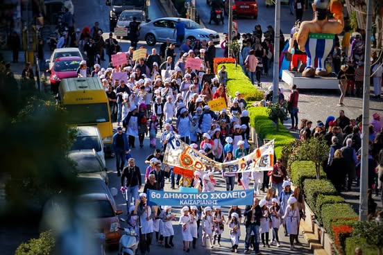
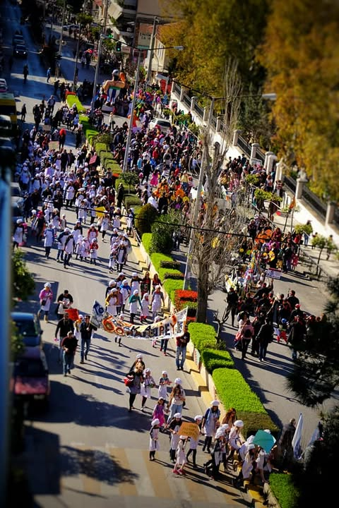

# So the Greek Orthodox Church declared today is a national holiday known as "Clea

So the Greek Orthodox Church declared today is a national holiday known as "Clean Monday".  This is apparently celebrated by not eating meat after midnight, to presumably avoid gremlin like behavior.

From sometime after noon until about 6pm this group of children, comic book characters, Greek gods and Ninja's walk in a six block circle accompanied by the loudest racket I have ever witnessed.  There are horn like loudspeakers mounted on all the street lights for this purpose equally adept at both playing shrill music or warning of air raids.

I found that standing in front of one of these caused my skull to resonate producing a jackhammer like effect of my brain pounding on my sinuses.  This resulted in instant, and semi-miraculous nasal drainage.  But one must be careful lest fillings, teeth and god knows what follow leading eventually to complete liquification.

Apparently this cacophony is to announce to all of Greece and a few nearby countries that it is time to gorge on all manner of meat for the next 24 hours.  The city all but shuts down in preparation for the horrors of the coming vegetarianism.

