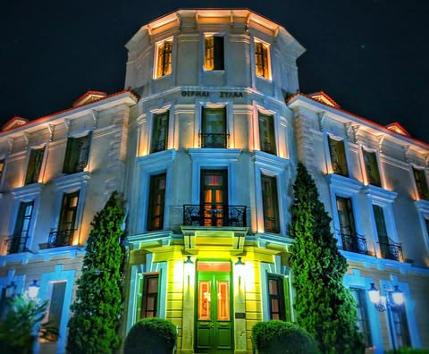
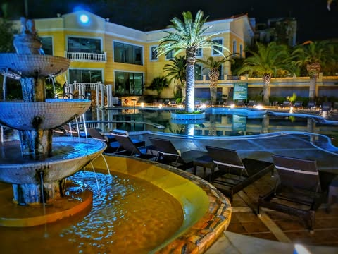

# Well, I am in Edipsos.  On an "island" that happens to be connected to the mainl

Well, I am in Edipsos.  On an "island" that happens to be connected to the mainland.  It is touted to be the location of over 80 hot springs, some over 185 degrees, which should be sufficient to leech the calcium from my dead bones.  My kind of place.  I came here determined to plop my worn out rear in some hot water until I tenderize.

So I went directly to the biggest thermal spa in town.
It was kind of a failure.  Basically It was a very expensive fancy looking luke warm pool.  With an indoor pool that was also slightly more luke warm.  The kind of pool Jesus would spit out.  Kind of like geriatric soup if you were avoiding leeching any of the tannins from the old people.

They were very serious about their slightly warm water though.  I had to consult a doctor and buy a swimming cap and flip flops for 15euros.  These are just normal rubber flip-flops.  Not hand made by Donald Trump or anything of that sort.

For 30 more euros I was allowed to bob around for 3 hours with my head-condom cutting off all the blood to my scalp.  They only sell three hours at a time, but they have warnings everywhere that it is dangerous to stay in over 25 minutes.  You would think that getting rained on in the summer would decimate our population.

The highlight was these spouts that would periodically blast an absolute torrent of warmish water.  But they seemed to turn them on randomly and to get under one I had to push through a forest of flabby old limbs.

I floated meditatively for 4 hours, sneakily avoiding the attendants patrolling.  Just so I could feel like I got my money's worth.  

The quest continues tomorrow.

