# The last of Hydra (face the ocean, go right.  Walk along the coast until you get

The last of Hydra (face the ocean, go right.  Walk along the coast until you get the chance to climb a couple thousand feet over the mountain.  See the other side.  Plod aimlessly for about 8 miles)

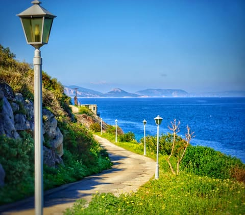

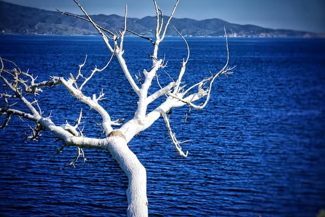

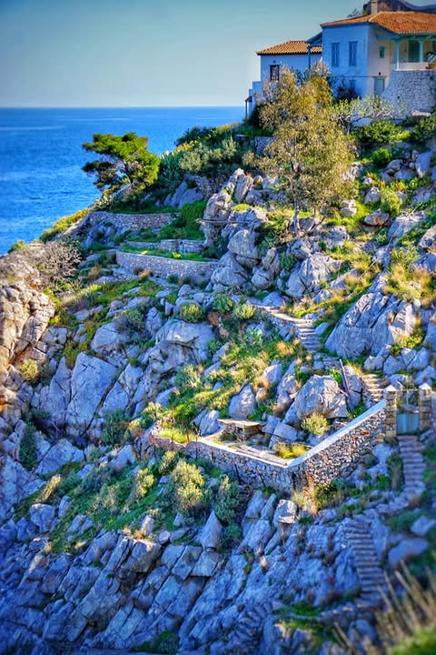

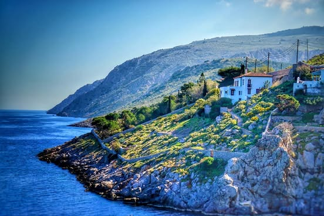

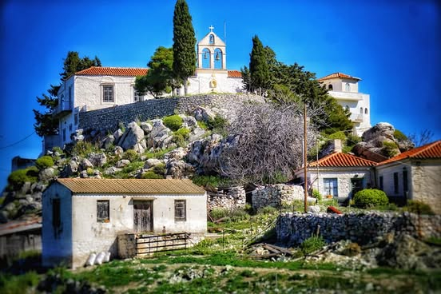

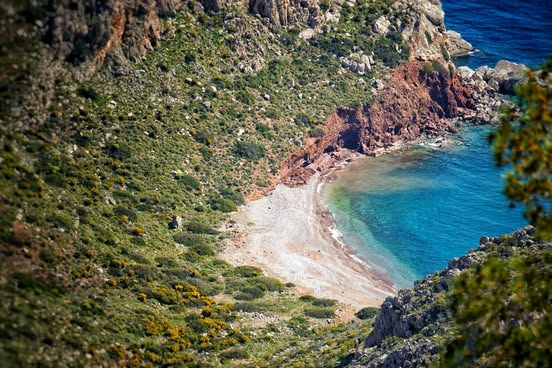

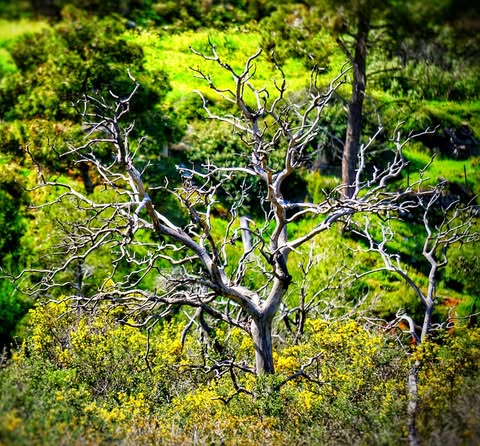

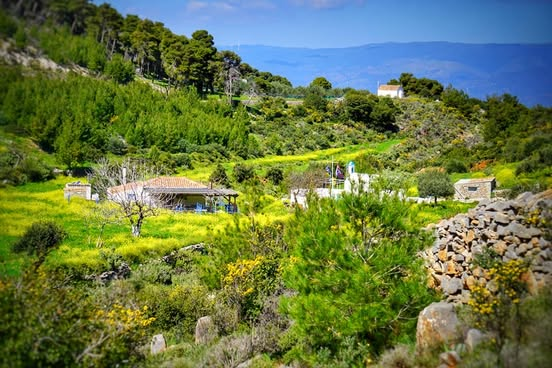

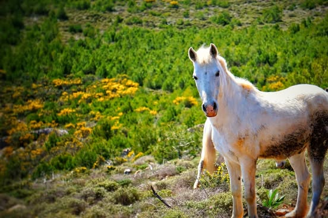

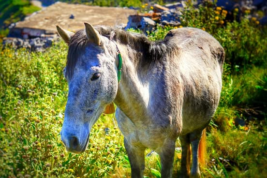

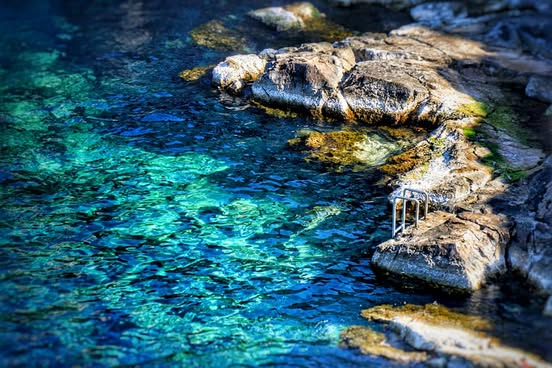

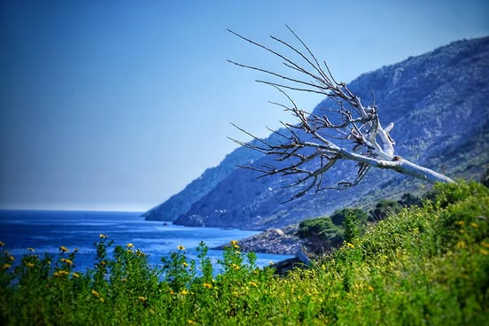

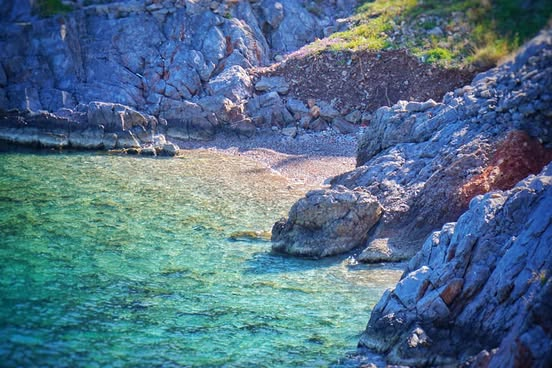

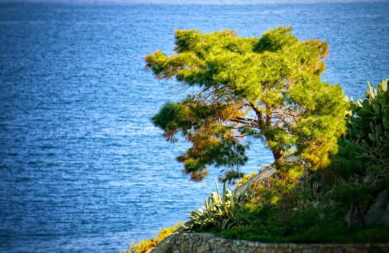

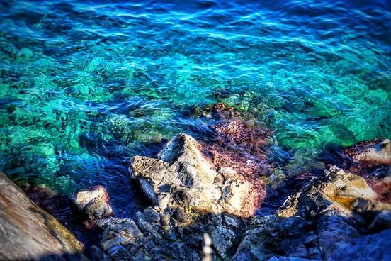

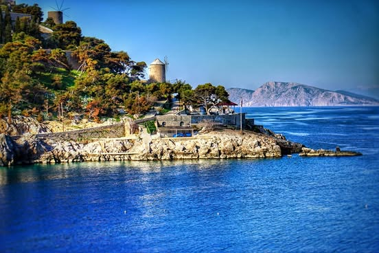

