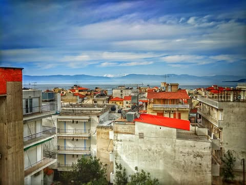
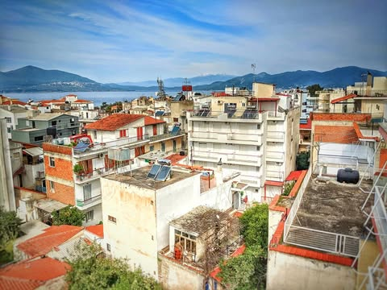
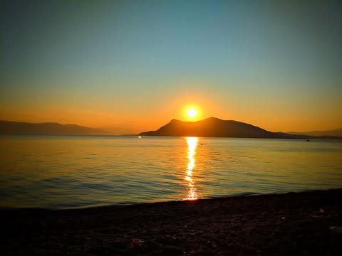
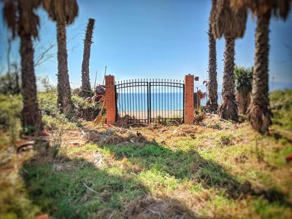
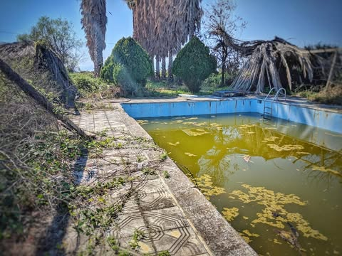
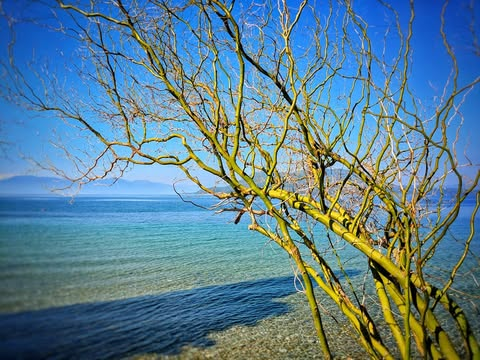
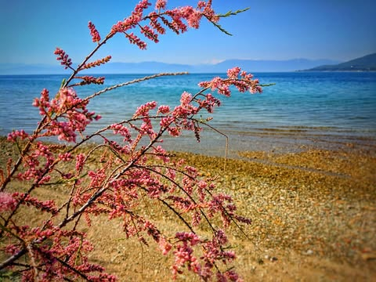
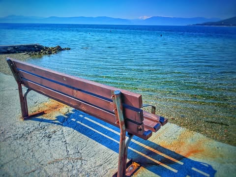
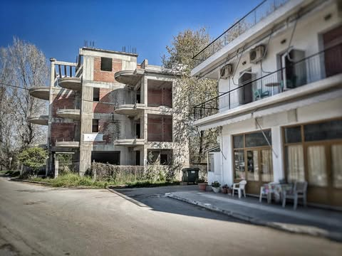
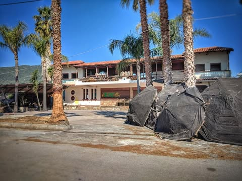

# Last day in Greece will be spent trying to find the right combination of public 

Last day in Greece will be spent trying to find the right combination of public transportation relying solely on pantomime.  

Goodbye Edipsos with your slightly warm and heavily guarded waters.  I want to go to the snow covered mountains in the middle of the first picture.  It was not meant to be.  I don't even know their name.

