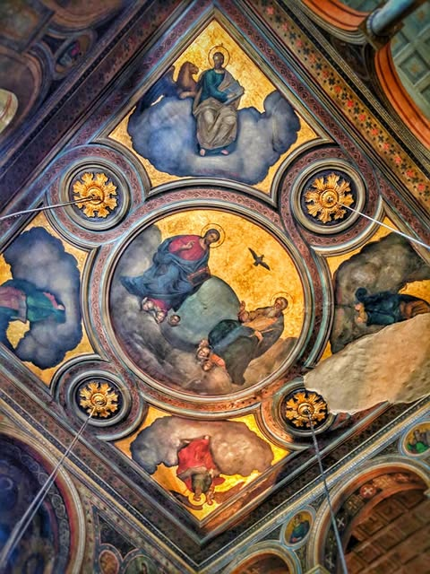
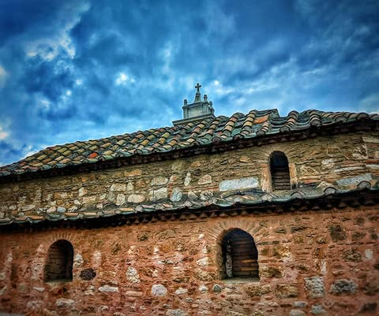
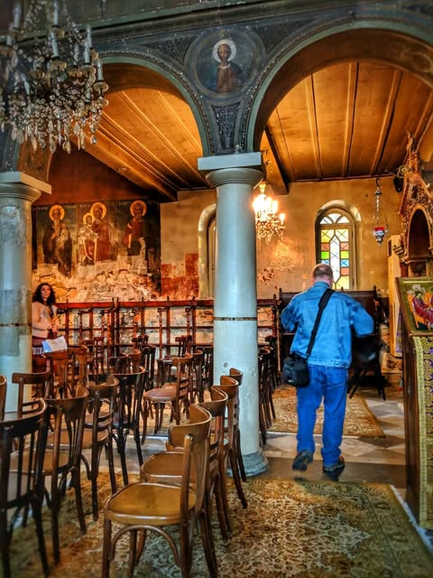

# Ever wonder what a church built in 500 AD looks like?  Well, wonder no more.  It

Ever wonder what a church built in 500 AD looks like?  Well, wonder no more.  It has been in continuous use ever since and is still active today.

