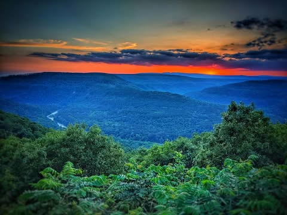
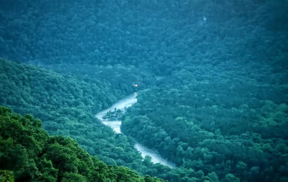
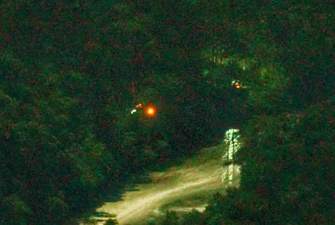
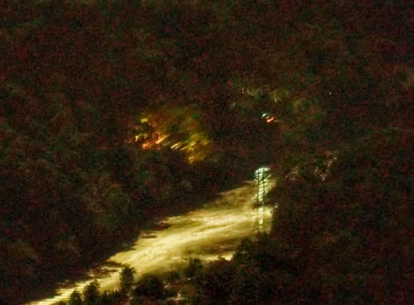
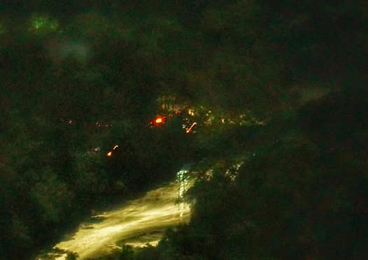
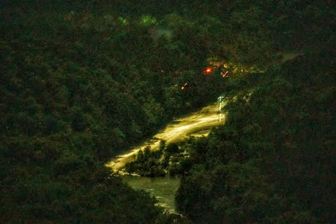

# Finally, after 15 years of trying, I got some decent shots of the Dover lights. 

Finally, after 15 years of trying, I got some decent shots of the Dover lights.  For those of you that have not heard about them they are "ghost lights" that sometimes appear on an uninhabited section of the big piney river about 15 miles north of Dover.  

They are seen usually in the bend of the river in the center left of the first picture from an overlook about 3/4 of a mile away.  The rest of the pictures are a close-up of that section taken with a zoom lens at a 30 second exposure.  Most of the lights were not visible "to the naked eye".  Except for maybe a brief flash.  Some of the streaks were lights moving during the 30 second exposure.

This is the first time I have seen them in the past 5 trips, and it was a pretty unspectacular showing compared to what I have seen in the past.  Hopefully I will get some better shots later if they are active again.

Before you ask.  I have no idea what they are, I have no theories to offer.

