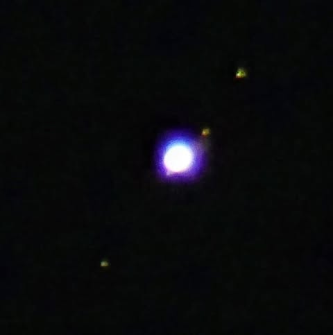

# So I heard that you could see the moons of Jupiter with binoculars at the moment

So I heard that you could see the moons of Jupiter with binoculars at the moment.  This is from a Meade etx60 telescope that I got at a yard sale for $20, 10 years ago.  $190 new on Amazon now.

