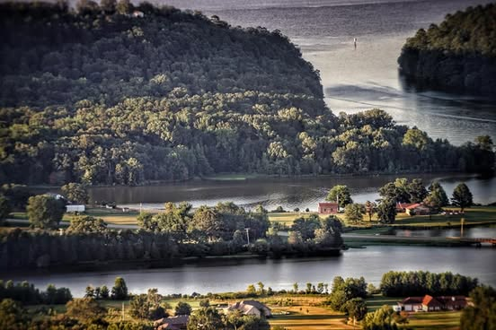
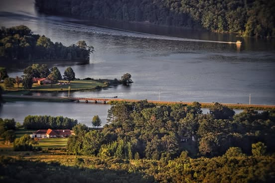
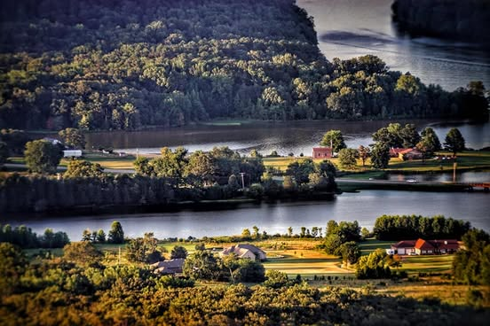
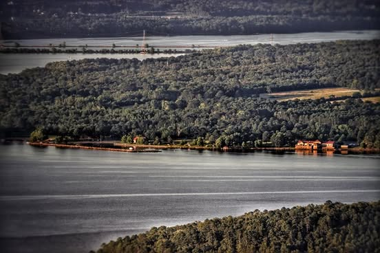

# Lake Dardanelle from Nebo at sunset.  About 4 miles away, taken with small teles

Lake Dardanelle from Nebo at sunset.  About 4 miles away, taken with small telescope with about 500mm focal length.  Last picture is the marina.

