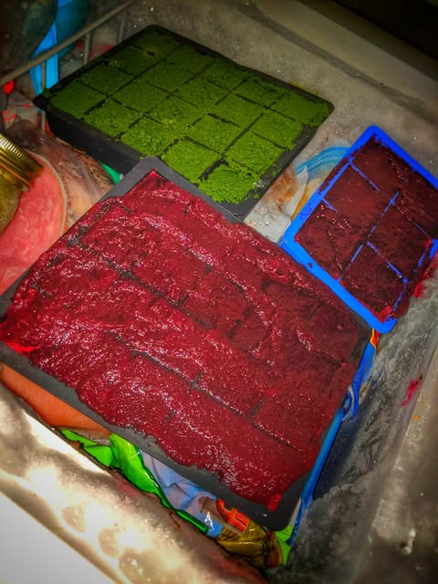

# Just made a fresh batch of dirt flavored slime cubes (kale /carrot & beet / cele

Just made a fresh batch of dirt flavored slime cubes (kale /carrot & beet / celery) to use in my daily morning sour sludge drink.  I add yoghurt, a lemon and a lime with some water and blend it all up skins and everything.

It tastes absolutely horrible.  But my gag reflex has never been stronger.  I keep adding different stuff to make it more palatable to no avail.

I have to admit that after a month of this stuff I feel much better.  So I am looking for any horrid tasting thing to add because apparently that is some kind of natural law.   I saw a toad yesterday and chased it around a bit before I decided it may actually improve the flavor and thereby thwart my ambitions.

The toad will live to see another day.

