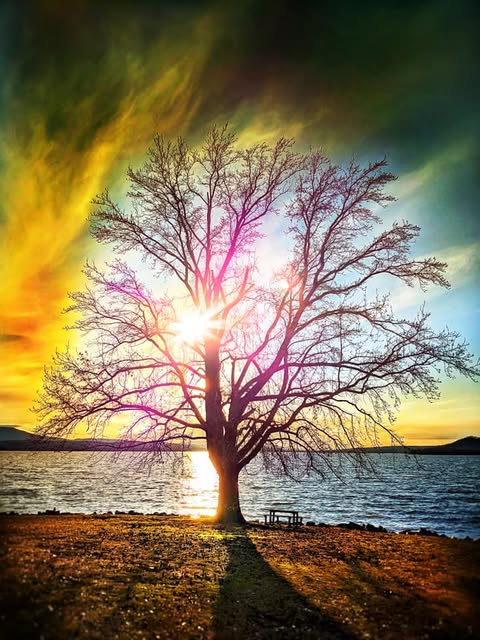
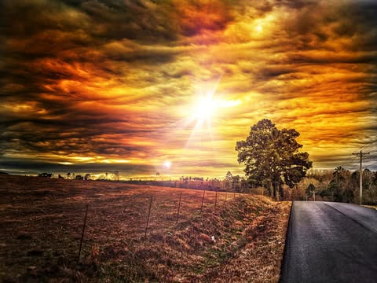

# I normally try to keep the editing I do on photos fairly minimal.  I use the Sna

I normally try to keep the editing I do on photos fairly minimal.  I use the Snapseed app, which is a free download.  Thought just for fun I would try heavily editing a few old photos.  Just to be clear.  These did not look like this.  Not at all.

