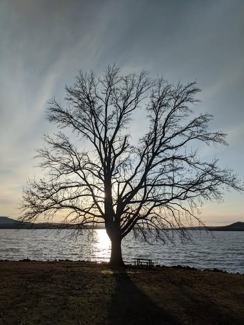
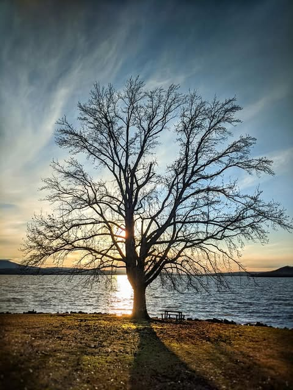
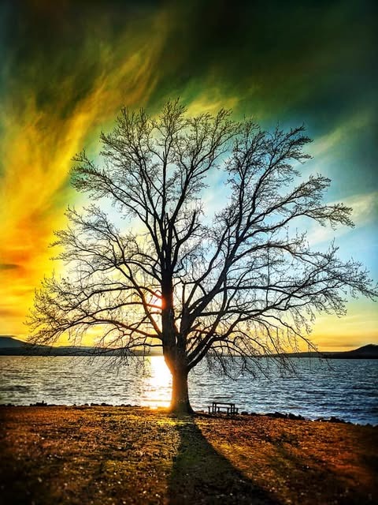

# So I am trying to figure out how much editing is too much.  So here are three ve

So I am trying to figure out how much editing is too much.  So here are three versions of the same shot.

The first is "straight out of camera", even this has some degree of enhancement done automatically.  Basically all digital cameras do this.  If I was trying to say it was what was there, this is what I would use.  So for documentary or journalistic purposes.

The second is how I usually edit manually.  It is more like what I saw in my head at the time.  I try to identify the subject and differentiate it from the background.  Hopefully it is still believably realistic.

The last one is heavily edited.  Colors changed drastically, elements added or removed.  Shadows and lightning changed.  It may be "pretty" but nothing like this physically existed on Earth.  Or at least I did not see it.

I am not making a value judgement, each can be done well or badly and requires skill or talent to accomplish.  I just don't know what most people prefer.

So most of the photographers I know use feedback on here to try to judge what they need to do differently or improve.  Likes / comments / shares are kind of a score.  I personally appreciate the positive comments but would find constructive criticism far more useful.  What do you like, what not so much.

Anyway, if you could say which of the above you prefer and why I would appreciate it.

