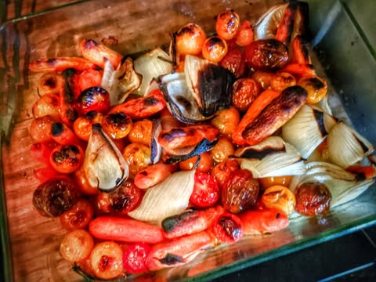
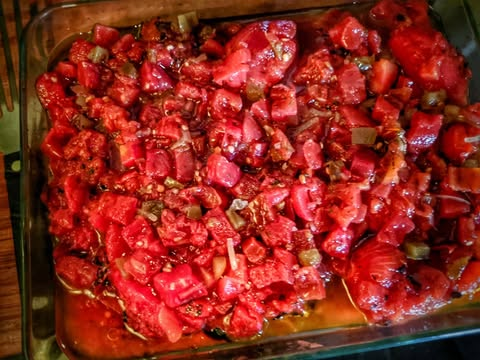
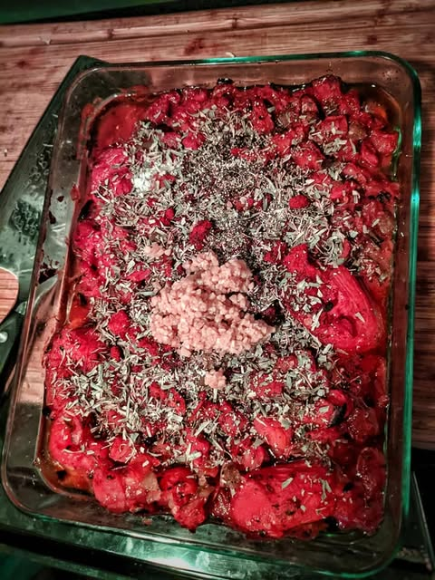
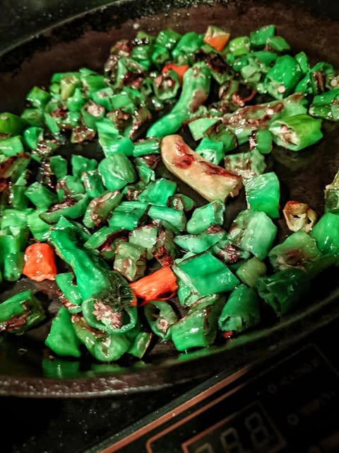
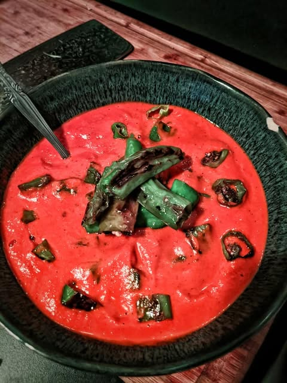

# I found what I think of as the Holy Grail of tomato soup.  It somehow manages to

I found what I think of as the Holy Grail of tomato soup.  It somehow manages to be without compromise tasty, healthy, easy, and cheap.  I made this in a crappy toaster oven.

First add cherry tomatoes, onions and carrots drizzle with olive oil and put under broiler for 30 minutes.  Remove, stir and put back for another 20 minutes.

Then dump a large can of stewed whole tomatoes on top and a couple small cans of some kind of seasoned tomatoes (I used Rotel and fire roasted).  Put back under broiler until it carmelizes a bit (30 minutes).

Add some spices, for example: smoked paprika, salt, pepper, tarragon, basil, rosemary, thyme, lemon zest, cayenne, garlic or whatever sounds good.

Add a cup of always save brand dry cat food.  Just kidding, don't do that.

Blend into Oblivion 

Taste and add more spices as needed.

At this point it is vegan and ready to eat.  If you want you can add cheese or cream or chicken bullion  but after you taste it it seems entirely unnecessary.  Somehow carmelizing it changes everything.

If you want you can add meat, sausage, mushrooms, or in this case toasted shishito peppers, so there is something to chew on.

Has enough vitamins to hold off covid ... Well, can't hurt in any case.  Lasts for at least 5 days in refrigerator.

