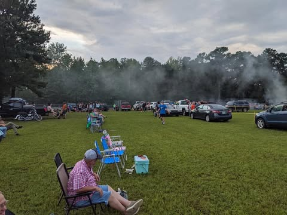
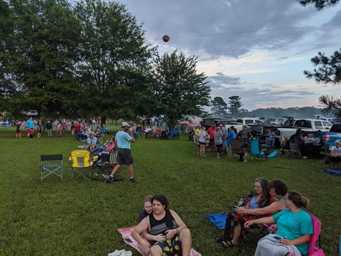

# Every year, between Russellville and Clinton in the tiny "town" of Alread Arkans

Every year, between Russellville and Clinton in the tiny "town" of Alread Arkansas.  There is an event they call a fireworks display, but in actuality is some kind of insane 40 minute long apocalypse simulation.  I usually find fireworks to be pretty but boring.  Not here.  Here they are directly over your head,  debris are falling on you, people are screaming at the top of their lungs and you can barely hear them. Smoke is so thick that at times the fireworks are reduced to just flashes of light and thunder.  At some point with the sky on fire, smoke filling your lungs and ashes raining down you go from being overwhelmed to considering this might be how you die.

I tried to capture the finale, it is about half way through this video.  But my camera seems to have also been completely overwhelmed.  Will have to figure out something different next year.

[video](../images/facebook/8e619af0cdd5bcbf.mp4)
