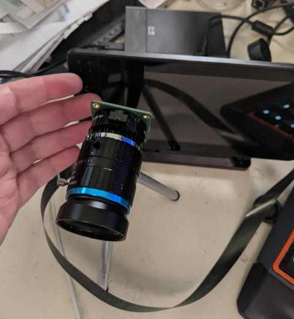
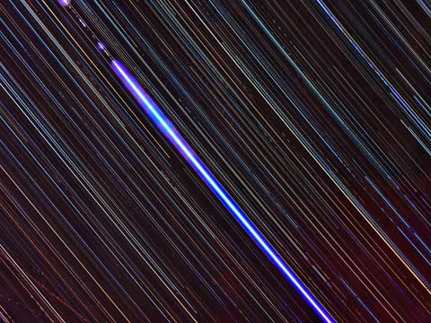
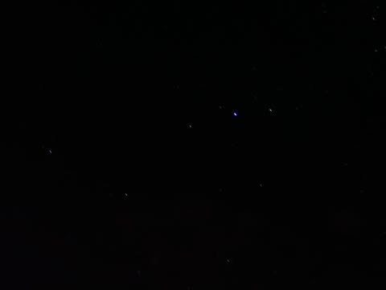

# So, got a new project.  This was just a test.

So, got a new project.  This was just a test.

The first picture is a small computer ($50) called a "raspberry pi".  It is attached to the HQ camera (the green bit at the back of the lens which is just a bare 12mp sensor $50).  It allows you to attach various C-Mount or CS-Mount lenses. This one is a 16mm f1.4.  (also $50).

So for $150 you can basically make your own camera that is completely programmable using any language you want.

This is the wrong lens for astrophotography... zoomed in too much.  I will try again with wide angle when I can get one.  Also I saved JPG's instead of raw, which was a mistake.

I heard that there was a meteor shower last night.  It was mostly clear but hazy.  I left the camera taking 30 second exposures every 30 seconds all night long, 10pm to 7am.  (you can take up to 200 second exposures with the raspberry pi high quality camera).

The second picture is timelapse video, followed by compositing all the brightest parts of each frame, and finally a single frame.

Does not seem that there were any meteors... at least not where I was pointing.  Oh well.

[video](../images/facebook/d4c7e72b6bcb3ad1.mp4)
