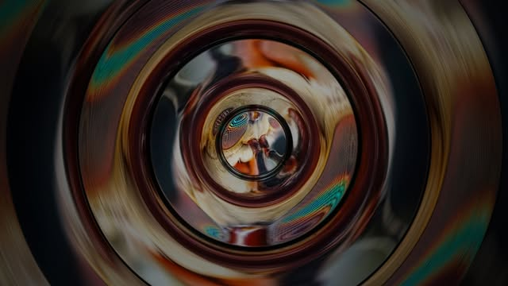
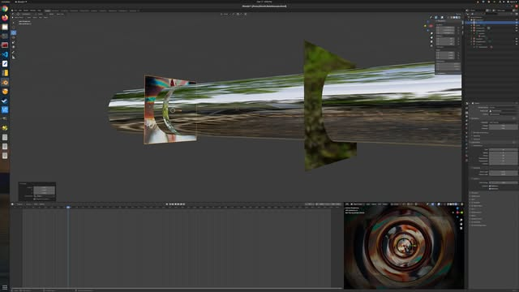
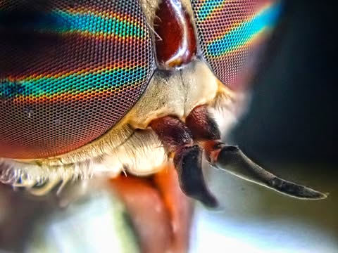

# Fun with a dead horsefly.

Fun with a dead horsefly.

I thought it would be interesting to get a kaleidoscope that I could put on my camera.  They make such things, but the ones I saw did not really accomplish what I wanted.  So I found out how they were made and then used Blender (a free 3d animation program... basically a light simulator) to build it.  Here are some of the results, of a fly and some trees.

[video](../images/facebook/485b3b7aed2ecdde.mp4)

[video](../images/facebook/16bfb19b9daa86d7.mp4)
