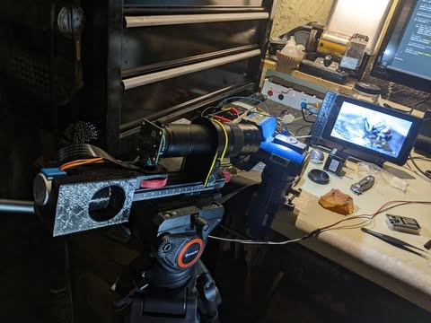
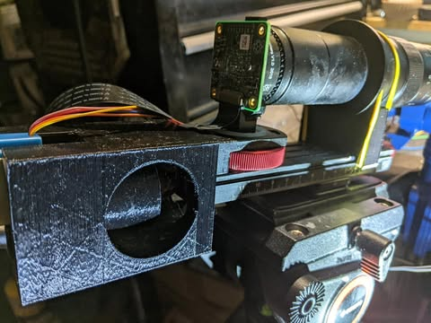
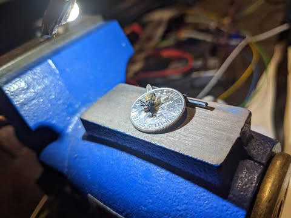
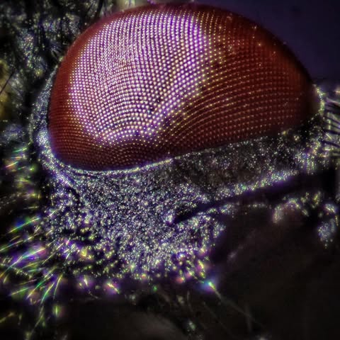
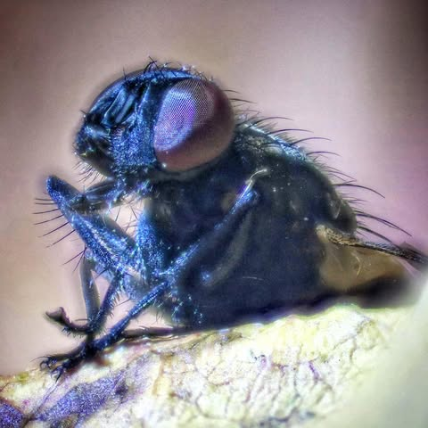
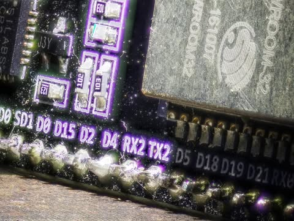
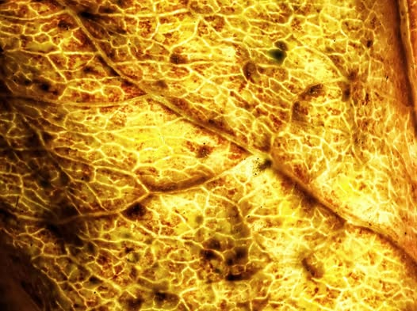
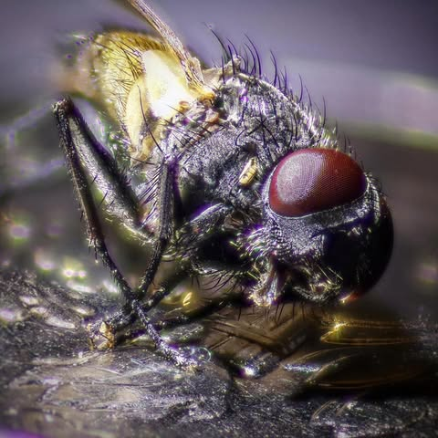
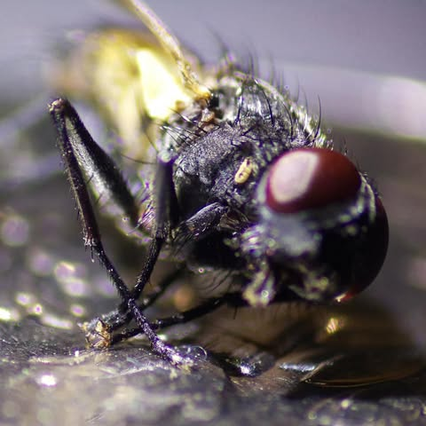

# So part one of the home-made auto focus stacking macro camera is done.  It is ab

So part one of the home-made auto focus stacking macro camera is done.  It is able to automatically take an arbitrary number of pictures while very precisely moving the camera forward fractions of a millimeter at a time.

Focus stacking allows you to get more of the picture in focus by taking multiple pictures and then combining the most in focus sections of each.  Normally with macro the depth of focus is very small.  If you look at the last pictures of the fly on a dime, there is a before (single frame) and after (50 stacked pictures).

The thing on top of the tripod is a focus rail.  You turn a knob on the end to make it move back and forth slightly.  The problem is that at this detail, touching it at all screws up the alignment.  So I attached a stepper motor to the knob with a 3d printed connector and a housing to hold the motor in place.  The stepper motor is the blue thing on the far left.

This allows for very precise and consistent movement without vibration.  

The whole thing is controlled by a tiny computer (raspberry pi).  I wrote some software to take multiple pictures while moving the camera forward a bit each time.  It can take 100 pictures at different focal points in a couple minutes.

The whole project cost about $200 in parts pi / camera / lens / motor etc.  Everything is open source.  The software used for alignment and stacking is hugin align_image_stack and hugin enfuse.

There is a bit of chromatic aberration that I need to fix and I need to refine the process some more.  But it is a good first step I think.

