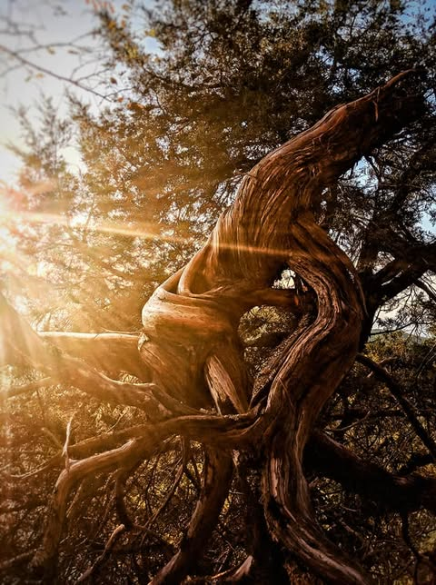
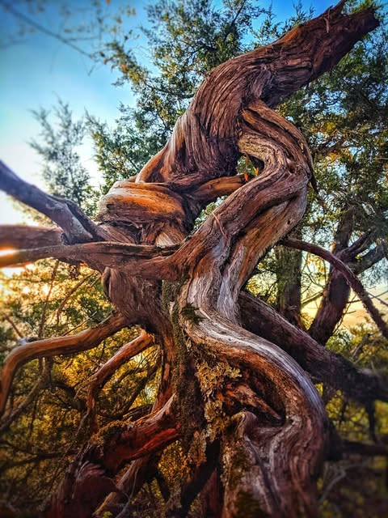
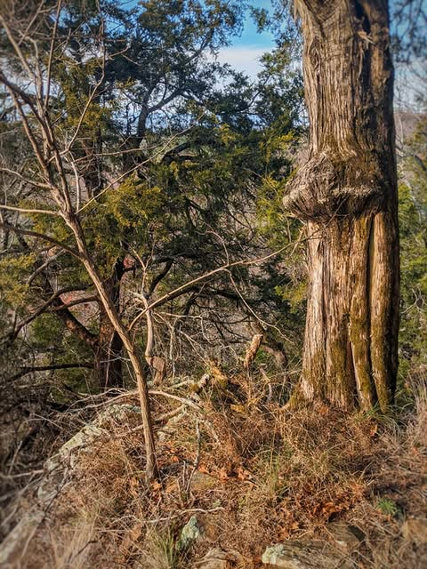

# Requiem for a stump. 

Requiem for a stump. 

Whenever I walk the rim trail on Nebo I went to visit this tree.  It symbolized perseverance.  I mean, look at it.  The elements twisted it completely around multiple times over the years.  The earth washed away from under it.  Still it endured.

Today I discovered that someone had cut it down.  It was not the park service.  It was not in the way of anything.  I expect it will never be seen again, except in the living room of whoever thought they deserved to see it more than anyone else.  

Goodbye old stump.

