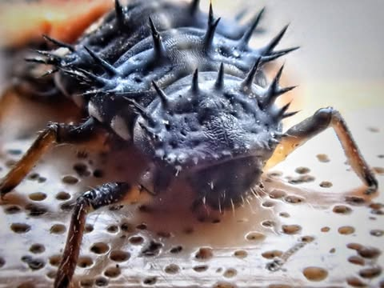
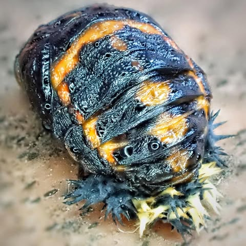
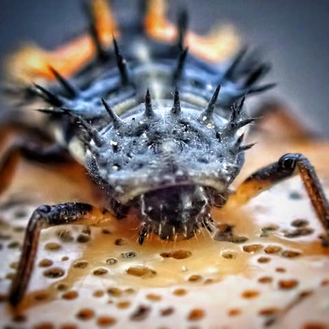
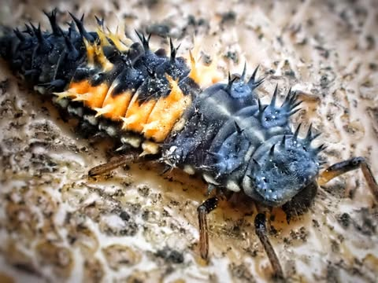

# A spiky bug of some sort in Morrilton's micro-park.

A spiky bug of some sort in Morrilton's micro-park.

Apparently it is a ladybug larva.  And all this time I thought puberty was rough for people.

