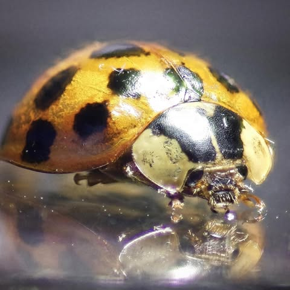
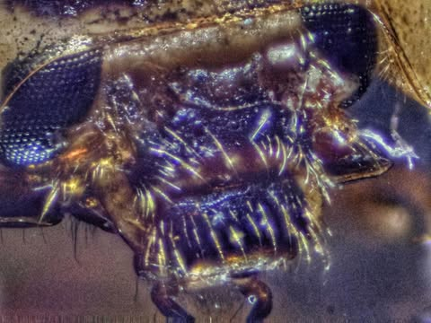
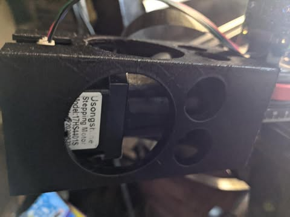
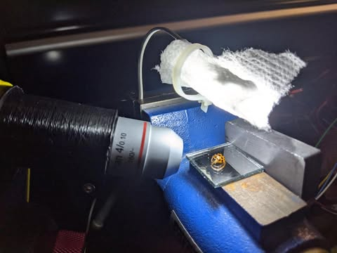
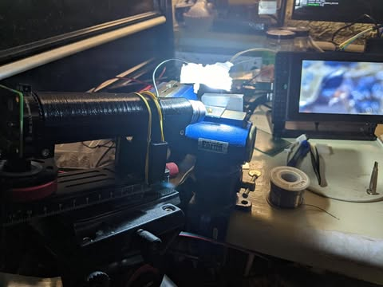

# I made some progress on the raspberry pi camera macro project.  Estee White: htt

I made some progress on the raspberry pi camera macro project.  Estee White: https://www.facebook.com/esteewhitephotography/ showed how to use a microscope objective lens on a camera.  So I got a 4x microscope objective lens for $25 and 3d printed the tube and attachments to connect it to the raspberry pi hq camera.  

Also I updated the tiny 28byj stepper motor $1 with a much more powerful and smoother nema17 $5

The first ladybug was with the regular zoom lens that I had before.  The second picture is just its face with the microscope objective.

I may be near the limit of what I can do with this $50 sensor.  But there is some stuff I can still try with lighting that may help.

Also having trouble moving the camera.  At this magnification my heartbeat causes significant movement of the table.  So I will have to work on a more stable mount or practice my ninja breathing skills more.

If anyone is interested in doing this let me know, I can share the files for 3d printing and the software.

