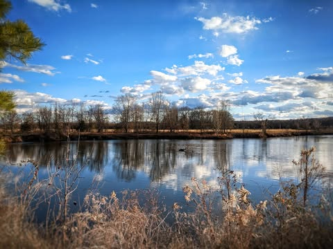

# What word describes the growth of apathy towards the spectacular or tragic?  Whe

What word describes the growth of apathy towards the spectacular or tragic?  When we grow bored with a sunset, or accept injustice as just the way it is?  The only thing I can think of is adulthood... But that seems too general.

*Location: Bona Dea Trails*

