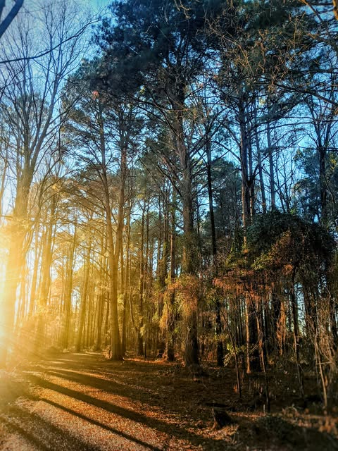

# I was walking a section of  bonadea  that has a bunch of huge old pines.  I've s

I was walking a section of  bonadea  that has a bunch of huge old pines.  I've seen them a thousand times.  Part of me thought how majestic they were.   Another part dismissed them as just a bunch of random trees.

I spent the rest of that walk wondering how much I had lost without even noticing.

There was a little kid yanking on his mothers pants to point out a bug or mushroom or something.  She ignores him.  I ignored him.  The only one among us that had not grown blind was unable to show us how to see again.

How do we roll back the decrepitude of our perception?  Are we destined to have sight without vision?

*Location: Bona Dea Trails*

