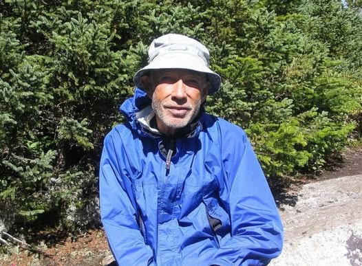

# The story of Turtle Don:

The story of Turtle Don:

In 2004 I through hiked the Appalachian trail.  There I met an old man named Turtle Don. He was walking so slowly when I passed him that I was sure he would never make it. He just took little tiny steps.  The other hikers could have gone faster on their  knees. 

The next day we passed him again. Then again the next day…. at this point we tried to figure out how he kept getting ahead of us. He had Alzheimer's and did not talk much.  It took us a while to figure it out.

We (everyone else) would walk until about an hour before dark, then stop at the first shelter. Eat dinner, rest a bit, sleep until 9 am or so and continue on. Turns out Turtle Don would walk until it got dark, then he would keep walking in the dark, then eventually he would just collapse in the middle of the trail and pull a blanket over himself.   Before the sun rose he would get up and start again. 

It did not matter if it was raining, snowing or hot he just kept creeping along. After about 600 miles his legs started retaining fluid and swole up to about triple their usual size. His wife came and took him to the hospital. We thought that was the last we would see of him. 

Four months later we are passing through the Mahoosuc Notch, probably the most difficult section of the trail, and there is Turtle Don. He is covered in cuts and skinned up from the rocks, his glasses are broken and he has dried blood on his head from where he fell. He was grinning from ear to ear and greeted us cheerfully as usual.  Of course he could not remember any of us.

Apparently he left the hospital and skipped ahead so he could get to the end point before the park closed on Oct 15. Then he would go back and do the section he skipped. We spoke with his wife, who was following in an old van.  She said he did not have long to live but was determined to finish before he died.

I don’t think, had we asked him, if he would have said it was difficult… it was what he wanted to do and he was loving it. It seems that is the way of life, nothing you do out of love is difficult.

Turtle Don - New Hampshire 2004

