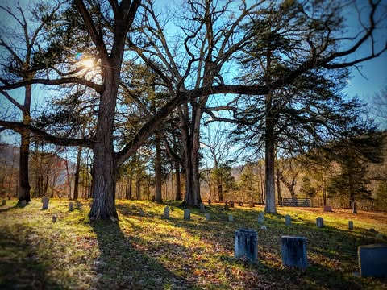

# I don't intend to die…. That is to say that I don't plan to notice being dead.

I don't intend to die…. That is to say that I don't plan to notice being dead. Basically at no point will the thought cross my mind that “well darn, I guess I am dead”. If such a thing were to happen then death would not mean what most of us think it does. If I am still having thoughts afterwards then it would probably be more appropriate to say I had transitioned than I had died.

And most of the world believes, for whatever reason, that some kind of transition is more likely than actual death.

But if actual death is what happens, it will be an entirely hypothetical concept that I will assuredly never experience. In practical terms eternity is nothing more than the time you become conscious to when you stop, the span of a life divided into infinite moments. It is all you have ever known and all you will ever know.

And death will play no part in my living.

One way or another I plan to live for eternity. I am not going to stress over imaginary concepts that I can never experience.

*Location: Parker-Hickman Farm Historic District*

