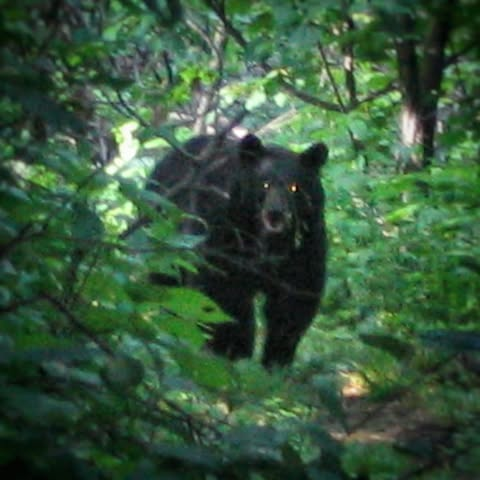

# The time I was almost eaten by a bear while trying to catch a hamburger:

The time I was almost eaten by a bear while trying to catch a hamburger:

Some sections of the Appalachian Trail are called "the green tunnel".  In these sections the bushes are thick interwoven walls of sticks and the only way through is to follow the tubular path.  In Virginia the trail parallels the Shanandoa Parkway through such a tunnel.

With not much to see, the mind wanders.  When you have been walking over a thousand miles when the mind wanders, it always wanders directly to food.  What you ate last, what you will eat next, will you be able to fit it into your pathetically small mouth fast enough that you don't go mad in the process?  I spent at least 7 hours telling some poor soul about taco villa meat and bean burritos.  This is not an exaggeration.

The shanandoa parkway has tourist stops for the people driving through.  The tourist stops have hamburgers.  And they close at 7:30pm.  In my dazed and panicked state this was literally the definition of the apocalypse.  If I did not make it I may very well consume my own arm.

With a single minded intensity that would terrify my current soft and sane self, I was barreling mindlessly along.

And then there was a bear.

Not a small one, like 600lbs of teeth that probably had the same thing in mind that I did.

I stopped immediately.  As did the bear.  There was nowhere to go, it was glaring at me about 30ft away.  I knew not to run... That was bad.  I heard if you could defecate on yourself it would make you less appetizing.  I pondered it, while a few minutes passed.

Apparently you can only maintain a state of immobilized panic for a few minutes until you become bored with having not died a grizzly death.  With boredom,  thoughts of hamburgers on a countdown resurfaced.

And then I started to explain to the bear about taco villa.  (Not really)

I took this picture below at this point.  Still not dead...hmmm.

Precious minutes were passing.  In desperation I tried waving my stick and yelling.  The bear seemed surprised by this, but did not move.  Still not dead... 

I did it a few more times before the bear turned around and shuffled around the corner.  

I went a little further and there he was so I repeated the process.

Before long I was running full speed, screaming and waving my stick while this giant bear ran away from his addled and uncooperative dinner.  This lasted for maybe a tenth of a mile before there was a break in the tunnel that allowed the bear to exit the path.

It was not until later, munching my four hamburgers, with about 10 minutes to spare, that I stopped to consider the events of that evening.

Imagine if some other hikers had been coming the other direction.  It's a popular trail.  The sight of a 600lb bear running from some dirty, sweaty deranged lunatic screaming his head off and waving a stick.   Coming straight at you down the green tunnel, with nowhere to run.  Hard to decide which would be worse.

Would have made quite a parade as we all scampered hamburgerward.

Luckily the only casualty that day, was between tasty buns and covered in cheese.

