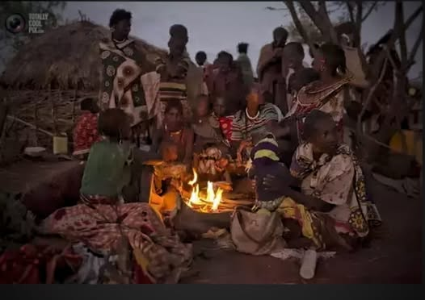

# The time I was poisoned, because I cured death, with fizzy vitamins:

The time I was poisoned, because I cured death, with fizzy vitamins:

When I was in in high school I lived with the Pokot tribe in Kenya E. Africa… this was back in the mid 80’s. My parents were missionaries, and the place we were stationed was about a days drive (over very bad roads) from the nearest gas station. We were the first foreigners that most of the locals had ever seen.

I was about 15 and had made a couple friends. They spoke some English and I spoke almost none of their language, but we went on hikes, hung out at their hut did the usual things 15 year old kids from completely different cultures did… maybe there is no such thing as usual in that circumstance, but we made it work well enough.

One day one of my friends came by looking particularly depressed. He said his dad was dying and there was nothing he could do to help. He knew we had a huge assortment of odd medicines that we were always handing out and wondered if we had anything appropriate to cure imminent death.

I went and gathered a random pile of over the counter medicines that we had collected. I knew none of this would do any good, but I figured I should try to do something. I got some aspirin, some foaming vitamin pills that you put in water… like Alka Seltzer. Some huge multivitamins we got in bulk somewhere, a bunch of mixed vitamin pills, some jell caps full of little colored beads (I think they were more aspirin) and whatever else looked interesting.

I really did not have much hope of curing death, but my friend wanted me to do something and this was all I could think of. A lot of the issues out there were from drinking bad water, so I also took some clean water and a glass. And off we went.

Turns out my friends family lived about an 8 mile walk away.  It was dark by the time we got there. The family was gathered around a fire in the yard looking miserable. They told my friend he should go say his goodbyes. It looked kind of like the picture (not mine...found on google)

But darker, and more miserable.

My friend came out of the hut and told me his dad wanted whatever medicine I had so I should go give it to him. I went in the hut and met his dad… who indeed looked on the edge of death. I put on the best show I could at making an impressive concoction. I broke open the pills and dumped the contents into the glass of water, handed him a pile of vitamins added three times the suggested amount of the purple foamy vitamin stuff in the water then told him to swallow all the pills with it as it was bubbling over the side of the cup.

He looked wide eyed at the concoction but drank it, choking down all the vitamin pills as well.

A few minutes passed while we stared at each other contemplating mortality… then he got out of bed, wandered outside and declared himself cured!

Everyone was amazed as he described the purple foamy potion I had given him. My friend was happy. All was well with the world! I figured that had gone better than expected and started to get ready for the hike back.

So here I have to digress to explain some of the local custom. The Pokot are nomadic herders, they have goats, sheep, camels, donkeys and cattle. They rarely kill anything though because with no refrigeration it has to be eaten all at once. 

It became tradition that whenever anyone butchers anything their friends, neighbors, family, can all come by and take some. Sometimes people will walk over 50 miles with their doomed livestock so they can butcher and eat it without people wandering in and taking most of it. Sometimes people chase them 50 miles to get a piece.

Now when my friends dad was a boy, he was walking around and found a large, misshapen chunk of metal out in the bushes. Nobody really knew what it was, we think maybe a piece of a tank, or maybe a vehicle or airplane. It was fairly thick metal and sort of bowl shaped… maybe held 15–20 gallons. He hauled this home and from that point whenever he got a piece of meat from one of his unfortunate neighbors, or had left overs from killing something that wandered through his yard, he would throw it in the glorious pot. Legend had it that he had kept this thing simmering non-stop for over 30 years.

Whenever he had cause for celebration, or a special guest, he would pull something out of the pot. It was an instant party. Turns out his “pot of many things” was kind of famous in the area. I had no idea.

Now of course my friend was pleased to tell me that having cured his father from death, I had the honor of getting something from this wonderful pot. The rest of the village all cheered and clapped. I thought that I might have figured out why he was “dying” in the first place.

I was introduced to “the pot”. It was awkwardly perched over a smoldering fire. Floating inside was several inches of cloudy looking grease on top of what looked like a layer of grayish oatmeal. I was supposed to reach into the warm mush and grab whatever I “wanted”. So I planned to find something that felt like cartilage, and definitely avoid anything spherical. I plunged my arm into the greasy sludge and felt around for something small…

I ended up with a little bit of some ancient meaty something that unfortunately had a larger bit of something dangling from it. Everyone looked it over and tried to guess what it might have once been and where it had come from. The verdict was that I had a piece of camel lung that had been killed sometime within the last few years. They briefly reminisced about how that was a good camel. I forced a big smile and tried to swallow it whole… which was kind of impeded by that dangly bit. I concentrated on not gagging and managed it somehow. Then immediately started chewing on a couple of the foamy purple vitamin pills to cover the taste.

Unfortunately swallowing it like that convinced them that I must be really hungry and being a miracle worker, I was entitled to more than the traditional one piece.

I did my best to convince them that I was full, but having just walked 8 miles, they were not buying it.

I had heard a rumor that some donkey bits had been deposited within the last week or so, so this time I thought I would go for that since at least it was comparatively fresh. So I stuck my hand back in the greasy oatmeal mush and felt around until I found a chunk of something that felt kind of spongy and meat like… and made sure it was not attached to any other dangly bits.

This one they thought was a piece of donkey brain from last week sometime. Success! It looked like a piece of fat, vaguely noodily shaped and covered in grey greasy slime. I popped it in my mouth and tried to pretend to chew without actually biting it.

Unfortunately I bit it by accident… it was juicy.

I instantly coughed up a bit of vomit, but forced myself to swallow it and the chunk of something before I spewed all over the grinning not-dead father standing in front of me.

My eyes were watering and my nose was running and I had probably changed to some shade of blotchy red which was a bit of a trick to my audience. I smiled as best I could and focused on not throwing up… which meant really not moving or breathing at all.

My stomach settled before I passed out and I instantly insisted that I had to go, “other peoples lives are depending on me” … or something like that. Then did my best super-hero impression by dashing off into the dark, where my friends later found me.

The real miracle was that even though I later tried to throw it up, I could not… and I never got sick from it. The old man was still alive when we left several years later.

