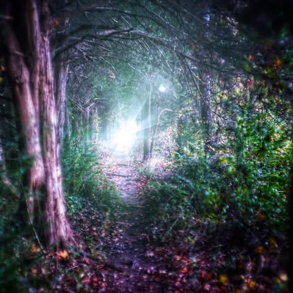

# I want to be a failure. 

I want to be a failure. 

To reach for that which exceeds my grasp.  But reach anyway.  To know my efforts will be inadequate, but make the effort still.  

To fail consistently, gloriously.

I want to be the child that falls while climbing the hill of sand then rolls laughing to the bottom.  The child that does it again and again until they are told the pile is too big and they are too small.  That their trophies of honor are just mud stains. They need to stop because it's not clean.  Because dirt marks the shame of having fallen. Foolishly tried and foolishly failed.

They will learn soon enough to join the huddle of the timid.  They will see that the pointing finger and mocking tongue can cut down the best among us.  Leaving us equally small.

And thereafter we will grasp only that which is at hand.  And we will look only at the feet of the cowardly as we stand among them.  

The "failures" will have left us alone, they shine too brightly for our dim eyes to see.

*Location: Ouita Coal Company Mountain Bike Trail*

