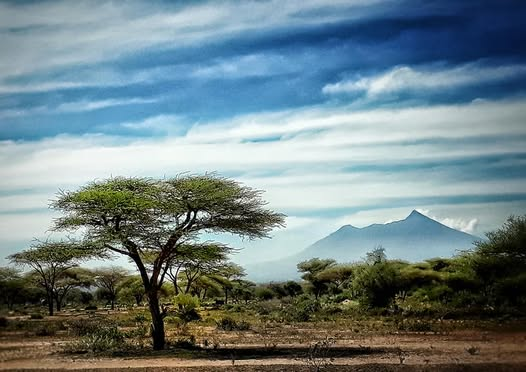
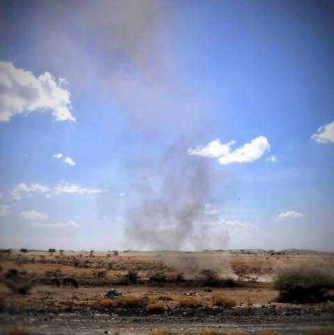
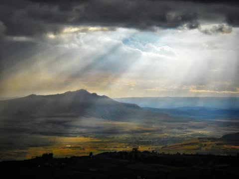
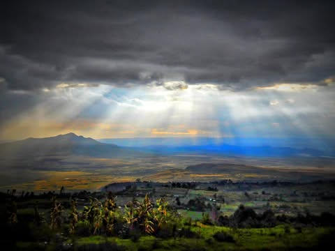
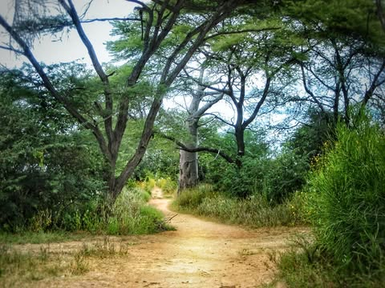
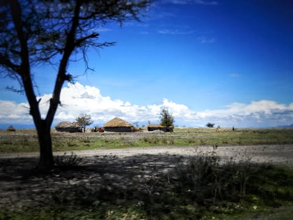
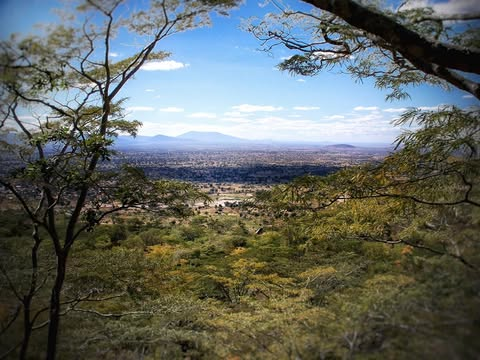
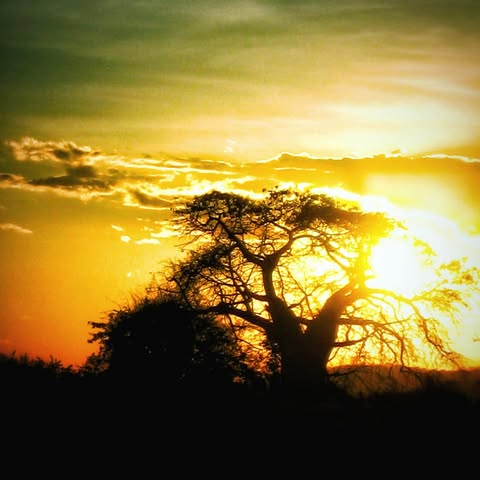
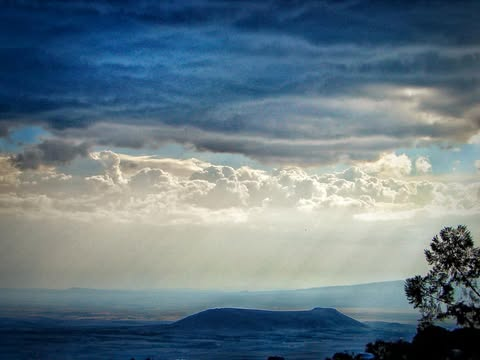
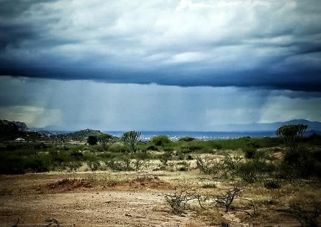

# The time we almost burned down the Rift Valley and were mocked by the pale horse

The time we almost burned down the Rift Valley and were mocked by the pale horse of the apocalypse:

My high school was a bording school (Rift Valley Academy), in Kenya.  It is perched on the edge of "the great rift valley".  A titanic tear in the African continent which some british dude keeps making documentaries about.

Imagine stumbling from your dorm at the crack of dawn every day.  Emerging among the clouds at 7000 feet to look down on thousands of square miles of grasslands lit by the red morning sun.  Two giant volcanoes, Longonot and Suswa dominate the view.  In the distance dust devil's thousands of feet high swirl slowly across the plains.  

16 year old you has a moment to take it in while blinking sleep out of your eyes.  Then your expected ignore all that to go sit in a flourecenly lit hole and learn algebra.

This was a land before the rule of "screens".  No internet, no TV.  Just books, daydreams and a multitude of alarmingly dangerous adventures kept just out of reach.  Imagine sitting in the cool grass with the sun warming your back while reading Asmov, Tolkien, Clark, H.G. Wells, Louis Lamore, C.S. Lewis as rhey tell stories of epic adventure.  Occasionally you look up and see the crater of Suswa, rumored to contain hundreds of miles of unexplored volcanic caverns.  Just 40 miles distant through 6ft tall dry grass in 100+ degree heat.

To we 16 year olds, it was an intolerable situation.

For the boys at least the school was lenient about hikes.   So long as we could do it in a day it was fair game.  Just no unsupervised camping.  We stretched that rule far beyond it's intended limits by getting up at 4am so we could hike to Longanot and back before dark.  We regularly climbed a series of waterfalls that were far more dangerous than the staff were aware of.

But Suswa was beyond our reach... Well, legally at least.

In our junior year four of us schemed a mighty scheme.  We pretended that during our one week midterm break we were going to stay with a missionary family in Nairobi.  Of course the family knew nothing about this.

A week was long enough to walk the 40 miles to Suswa, explore the vast cave and return victoriously to forever gaze upon our mighty conquest.

And so, at the appointed time, we mashed as much food and water into our bookbags as we could and snuck away down into the valley.

There was a "paved road" that we could follow most of the way there.  It was clearly visible from our school.  Up close it looked like someone had transported a long narrow strip of lunar regolith, craters and all, then meticulously surrounded the holes with asphalt.  Nevertheless, giant trucks lurched along this path periodically kicking up clouds of dust for us to inhale.

At one point we watched a dump truck, honking frantically, blocked by a heard of about 20 giraffe.  They stood there ignoring him, before casually strolling out of the way.  When the truck went through they wandered back onto the road.  And then looked at us just kind of standing there like idiots.  We did not know what to do.  We had nothing with which to honk.  These things might look kind of silly on TV, but they are known to kick lions to death.  And we, somehow, had their undivided attention.

Not knowing what else to do we just slowly started walking towards them.  Suddenly they all simultaneously freaked out and went running into each other and in all directions.  I expected if they could have screamed Eeeek and jumped on a table they would have.  I guess they saw giant trucks all the time.  Four tiny white kids were another matter.

As it started getting dark we saw a cluster of thorn trees out in the grass and decided to camp there.  So we made our way towards them hopping up and down to keep them in site above the grass.  As it got dark the wind was picking up so we carefully cleared a spot so as not to light the dry grass with our campfire.  We set up a couple tents and made a fire ring against an old log that would block the wind.  We kept the fire small.  Just enough to give us light and make some hot tea.

What we did not notice was our log was hollow.  While we were basking in our cleverness and admiring our woodcraft, the log was belching flames out of both ends into the dry grass.

We panicked. While futilly stomping the grass at one end, admiring the smell of burnt hair coming off our legs, the other end burst into flames.  Then the wind blew the fire directly into our tents.  

We did not want to be known henceforth as the four stupid white boys who burned down the Great Rift Valley.  As told by some smug british dude in a future documentary.

In desperation we dumped our drinking water on the tents.  Then threw our tea.  Somehow it seemed we might have stopped it but every time we stopped another spot would flare up and we would have to madly dash over to it and resume our dancing.  Someone, showing remarkable wisdom, started peeing on some smoking patch.  We all started furiously peeing, then having run dry, we tried spitting.

Finally it was out.  We stood panting... Waterless, tealess, urineless and tentless, 30 miles from the nearest water in the middle of the african plains.

And then it started to rain.  And that, boys and girls,  that was how the rain dance was exported to Africa.

We stupidly just stood there panting in relief.  Then it occurred to someone that we should refill our water.  The only way we had to manage this was to use the burned scraps of tent to funnel it into our bottles.  As soon as we started doing this the rain quit.  We had a couple cups.  

The grass was damp though so we sponged as much water as we could off the grass with our sweaty t-shirts.  This got is a few more cups of burned plastic and armpit flavored water.

We were tired enough that we just lay in the ashes of our great plan and went to sleep.

The next day we resumed our walk.  It was closer to continue towards Suswa, where we assumed there was water, than it would be turning back.  Nobody wanted to drink our  sweat water, but it got hot quickly and so each person got about a cup to choke down.  A few of the potholes had bit of slimy mud water that we could sponge out with our shirts.

And then along came a dump truck.  

Observing the novelty of four muddy, singed half dead looking white boys on the side of the road, the driver stopped.  When he found us to be not quite dead he laughed and told us we were fools.  We nodded in agreement.  There was nothing else to be said.  

There was a "duka" a small shop 10 miles down the road and he offered to give us a ride.

We were not exactly wealthy back then, and having not really anticipated this situation we only brought a little money.  But it was enough to buy about 10 bottles of warm soda each.  We drank about half on the spot and then continued clinking along toward Suswa.  Now only a few miles distant and a couple thousand feet up.

When we reached the edge our second miscalculation became apparent.  The caldera is huge, about 8 miles in diameter.  And there were no signs indicating "cave here", "water over there".  So we shambled about with no idea where to go next.

At some point around dusk a local heardsman saw us, thought we were amusing and came to make fun of us.  He agreed to show us where water was and then point us towards a cave.  There is no water in the crater, but there are steam vents.  The locals had set up a series of pipes in the vents that would cause the steam to condense and dribble out some hot sulfurous liquid that tasted like rotten egg soup.

We drank warm rotten egg water until our stomachs sloshed about when we walked.  Then filled all our bottles and went lurching caveward.

I don't think we would have found it if not for the bats.  At dusk they began pouring out like thick smoke rising into the sky.  These caves are huge. There are so many bats that they used to mine bat dung out of them using train cars in order to make gunpowder.

The adventure centers in out brains lit up despite the exhaustion.  We set up camp at the entrance ready to explore come morning.

And morning came, and we were covered in crap from the bats coming back home.  Shitty as that was we hardly cared.  The entrance was huge and mysterious and we had hundreds of miles of underworld to explore.  We smacked our antique flashlights until they flickered on and thus began the descent.

And descend we did.  At first just, over our shoes, then to our knees.  Then to our chests.  Into the accumulated bat dung that they had stopped mining fifty years ago.  The bat dung smelled terrible and was covered with small spiders that fed off the beetles that fed off the dung.  Spiders crawled on us, bats swarmed around us. Apparently unaccustomed to having human shit divers playing in their septic tank.

Even this would not have stopped us were it not for the methane.  That volume of decaying feces emits enormous amounts of gas, we were getting light headed and dizzy.  

One of us managed to talk the rest down by pointing out that we would soon pass out and be literally buried in shit.  This was not the glorious death we had anticipated.  Not even close.

We made it back out and found a few other small entrances.  All reeking of methane and littered with bones.  We found a leg bone that was as tall as we were and in an instant visions of our glorious return  resumed.  We had discovered dinosaur bones!  We would be famous!  Then we remembered we were in Africa and giraffes were all over the place.

Someone pointed out that something had dragged a dead giraffe onto this pile of bones.  So we looked into the darkness and slowly backed away.

We camped again and then it was time to return.  We had rotten egg water but were running out of food.  

The way back was long and monotonous.  At midday it was scorchingly hot and dry.  We stuck to the road.  Having lost enthusiasm for this adventure, covered in drying bat crap and smelling... Well like you would expect, we plodded along.  The miles passed in a daze, one foot in front of the other staring at the ground, trying not to stumble.  Nobody was in the mood for talking.

I hear a grunt, and someone says a less pollite version of "look ye yonder at that mysterious vision!". I look up to behold the pale horse of death.  I kid you not, the harbinger of the apocalypse stood about six feet away staring at me.  Its eyesockets were hollow holes, horns rose from its skull, ragged dry skin stretched over it's frame, bones poked through rents in the flesh.

I would have pissed myself had I had it in me, I may have shit myself but nobody would have noticed the difference.  I did manage to scream like a litte girl, jump feebly into the air and land on my ass in the road.

My "friends" started laughing.  Apparently someone found a large gazelle that had been flattened on the road and propped it up in standing position.  I appreciated the humor in retrospect, at the time I just started walking again.

We eventually made it back and showered until the hot water ran out, and then for about an hour more.  I don't think we were even able to brag about it to our classmates at the time for fear of getting in trouble.

But that was the time we set out to conquer a volcano only to have it literally shit us out in defeat.

*** 
The pictures are from an old classmate Melissa Barnett Eager  who is now a teacher at the school we used to attend.  She agreed to send me some that I could edit.  They are typical of the view we had every day, and every day failed to appreciate.  

The participants in this story were Andrew Clarke , Russ Berry , Aaron Brent and myself.  
***

