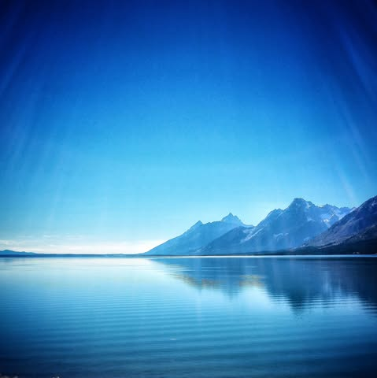

# The foolishness of man:

The foolishness of man:

Arguing with a three year old can be frustrating. In their innocence they quickly expose our ignorance. They only have to keep repeating the same words, “but why?” and “how?” in various forms. They know they don’t know, they have not yet learned to fear their ignorance.

Older and wiser, we confidently claim to “know” things. But with little effort our foolishness is quickly revealed.

One might ask: Here I am, Where did I come from?

The atheist might assert that you and your ancestors evolved from simpler organism over millions of years from the first single-celled organisms. “But where did those come from?” There was a chance occurrence that instantiated self replicating organic matter in a “primordial soup”. “But where did that come from?”. From the earth forming from interstellar dust and particles trapped by the suns gravity over billions of years. “But where did that come from?” There was a “big bang” in the distant past from which all matter spontaneously formed and we can see it expanding ever since. “But where did that come from?”... and at this point we don’t know… it just did.

The theist might respond: God made you. “But where did God come from?”. He always was. How can that be? We don’t know. “Why did he make me?”, because he loves you and wanted you to be here. “But why?”. We don’t know. “But how do you know?” Because the preacher / imam / prophet / guru / parent told me and I respect them and their wisdom.

Or one might ask: Here I am, what am I made of? The atheist might explain you are made up of molecules. “But what are they made of?”, Well atoms. “And what are those made of?” Subatomic particles, protons, neutrons, electrons. “And what are those made of?” Well, quarks, baryons, leptons, strangelets. “And what are those made of?” ... Again, We don’t know.

This rabbit hole goes forever.

And there are a lot of things we don’t know. We know what gravity does, but not why or how it does it. We have a name for what makes atoms hold together but we don’t know why or how it exists. We see light, but we don’t know whether it is a particle or a wave or both. We can model behaviors mathematically, but when observed behaviors don’t match up we invent “dark matter”.

We have accumulated greater knowledge than any time in known existence and it floats in a void of profound ignorance. Ours is a struggle to find small pieces that fit together while for our sanities sake pretending it is connected to an objective reality that is beyond our comprehension. 

I gaze in wonder at the technological and scientific achievements we have made. My cat gazes in wonder that I am able to consistently pour food from a bag.

Atheists tend to prefer to look at what they can see before them. They usually acknowledge the abyss but dare not look too deeply lest they become disconnected. There is a deep denial that their rationality not be reduced to another faith. Theists look with a mixture of fear and hope and say “God is in there.” Then given enough silence they presume to start speaking in his name.

We are trying to hold the ocean in a teacup.

Two men meet on the shore of a vast sea. They each scoop up a cup full of water then turn their back to the ocean and gaze wonderingly at what they hold. What they comprehend. What they controll. A long time passes, one says to the other “God made me specifically to find this water. He revealed it to me, led me to find it, taught me it’s meaning. I was chosen.” the other says “Fool, there is no God. Look at my water… I found it myself. I studied it. I understand it. I don’t see yours… its not even  real.” 

As their animosity grows the sound of the ocean endlessly churning behind them is forgotten… ignored.

I have never seen God… nor heard his voice. Neither have I seen the asteroid belt, Europa orbiting Jupiter, or an electron orbiting its nucleus. I hope in these things.  Because they help me understand my reality. Although my experience is lacking I chose to trust those who claimed to have seen something I have not. I chose to believe based on how I see this knowledge affecting their lives. On their humility rather than their arrogance.

We all have faith, in men, in gods, in institutions. We all believe in things we have not seen for reasons we cannot explain cannot repeat and cannot test. We are all afraid to be wrong and to look foolish.

Atheists, Theists… their pride will forever block the way.  The most honest is still the three year old who is not yet ashamed of his limitations and has not learned to fear the unknown. His is the closest approach to truth.

*** Photo is of Jackson lake in the Grand Tetons ***

