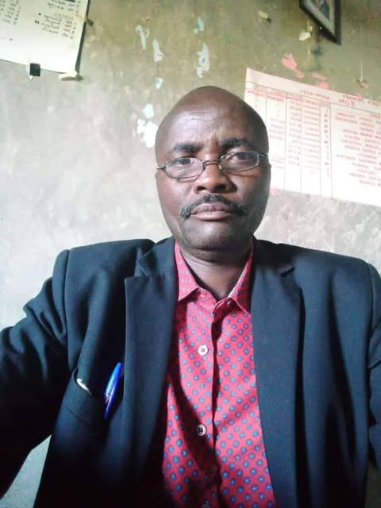

# An epitaph for my childhood friend Nelson Lonisa Kordado:

An epitaph for my childhood friend Nelson Lonisa Kordado:

As you might surmise from the title, this story will end badly, will not be humorous.  Nevertheless I thought, as the memory is now all that remains, that it should at least be told.

When we first moved to Kenya I was in seventh grade.  We moved there to assist my grandfather who had more or less lived in Africa his whole life and was now starting to struggle physically.  He lived in a small sheet-metal shed which he gave to my parents and three brothers when we arrived.  He moved himself into an even smaller shed.  Our new house was not really big enough for the whole family so I lived in an old tent in the "front yard".  

When they talk about the rains in Africa, they do so for a reason. There are only two seasons, the rainy season and the dry season.  During the dry season, months pass with no rain at all.  Then during the rainy season it rains almost every day.  Being a mountainous grassland you can see the storms coming from  a hundred miles away.  The lighting and thunder become prominent as they approach, then the smell of the air changes.  And then the deluge.

So one day, sitting in my tent trying to study (I was homeschooling that year)  the rain and wind slammed into my tent.  There is not any topsoil to speak of where we were and the tent stakes were just kind of poked an inch into the rock, it was insufficient and down came the tent.  A puddle had formed on the floor already which was rapidly turning into a stream.  I went out into the rain and grabbed a stick to try to dig a ditch that would divert the water.  A pro ditch-digger I am not.

There was a kenyan kid about my age that for some unknown reason was just standing in the rain.  We were used to being watched constantly, our incomprehensible antics we were likely the most entertaining thing that had happened in living memory.  But most of the observers left when it started raining, and they always just watched from a distance.  This boy however, just grabbed another stick and started helping me dig. 

We got the tent back up and I invited him inside.  He did not know any english, but had started learning it in school.  I did not know any Pokot, and was too lazy to learn any such thing.  Consequently our conversation consisted of me showing him soggy trinkets in my tent, books, flashlights, etc.  while saying words that had no consequence whatsoever.  Later he came by again, and we started going on hikes.  He gradually learned enough english so that we could have rudimentary conversations.  His name was Lonisa.

A few years passed.  I was in boarding school now a couple days drive away.  The way our school worked was we were there three months and home one month.  So every three months I would come back to our mission station (Maron) and I would hang out with my friends, Lonisa and his friend that he introduced me to, Peter.  They had a mud hut they had built, they both lived in it at the time.  I would walk down to their hut several miles with a kerosene lantern in the eventing and we would tell stories and drink Chai around a campfire.  Chai was just the Kiswahili word for tea.  Their hut was about 10ft in circumference with a grass roof and some bunk beds that they had made out of sticks.  The entirety of their possessions were a bow, two arrows, a suferia (aluminum pot), the clothes they were wearing, some old shoes, a notepad and a pen that were only for school, a small knife they shared and a stick they used for stirring the tea.  They also had one cup... so we would take turns drinking our tea.

It was an odd friendship, we were from entirely different worlds, but it gave us a lot to talk about.  I told them about abstract things like computers, novels and movies.  They told me more concrete stories like their plan for how they would get food tomorrow, and a spot that they were going to try to plant some old pieces of corn in.  They also had stories, about giants, who apparently were white hairy people who stole children and ate them, and others where hyenas and rabbits had obscure conversations that ended badly.  They told me I was wrong about the stars, they were really campfires of people who had died and floated into the sky to watch over them.  So we toasted the stars, with our one cup of tea and a stick.

We went on hikes all the time, once to a mountain called Tiati which took a week.  We tried hunting many times and failed embarrassingly each time.  When the rainy season came we would watch the flash floods carrying rocks down dry creek beds splintering trees that stood in the way.  Then we would swim when the violence had passed.  During the dry season we would go to the cliffs and watch baboons acting remarkably like humans on a vertical stage.

It was a strange friendship as different as we were, but we made it work.

When I left, I did not expect to ever hear from them again.  There was no internet, or even phones or post offices anywhere around where they lived.  So about a year ago I was surprised to be contacted by Lonisa (now calling himself Nelson) on facebook.  He had become an elementary school math teacher.  He had married and had eight kids.  He named his first son after me.  He sent me a picture... he looked old.  I sent him one, I also looked old.  We talked about how life was over here. He was concerned about President Trump, and worried about how our country was suffering from COVID.  Kenya was doing better he thought, at least out in the country were there were fewer people.

I asked what a cup of chai cost these days.  He said two shillings.   The current exchange rate is 100 shillings to the dollar.  I was drinking my $5 cup of coffee at the time.  It would have lasted him several months.

His house burned down one day.  The other teachers got together and raised some money.  I sent some as well.  The government was supposed to pay him $200/month to teach, but because of COVID they had not paid anyone in nine months.  WIth eight kids I knew he was struggling.

Later his dad died.  He has been sick for years, it wasn't covid.  Just declining health.

Then I didn't hear anything for a while.  

A few weeks ago Peter contacted me.  He said Lonisa had been on his way back to teach, had been in a store eating lunch with five other teachers.  A van pulled up, they were forced into it.  Their bodies were found several miles away.  

There was no investigation that he knew of.  Tribal conflicts are common over there, unless you have money things like this tend to just go unnoticed.  I sent Peter some money to give to his widow.  He also gave her some of his own, I know that was hard.  I told him to have her contact me directly.  I was going to try to do a gofundme or something to help support her and his children.  I never heard back.

Yesterday I got another message from Peter.  Lonisa's wife, another lady, and a small child were riding a bike and ran into a goat.  The bike went over a cliff, killing her and the child.  The other lady is badly injured but survived.

I don't know that there is anything that can be done.  Those who have read this far will never get to meet Nelson Lonisa Kordado.  He had hoped to come visit the United States, or hoped I would come visit him in Kenya again.  That will never happen.  But he lives on in my memory.  Now perhaps that which remains can live in yours.

--------------------------------------

Edit: I created a fundraiser for anyone that is interested in donating to the school expenses of Nelsons 8 children.  Please donate if you are able:

https://www.facebook.com/donate/1557802157943161/

