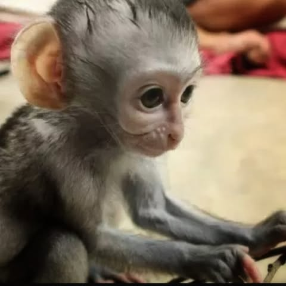

# The undignified days and untimely demise of Twit the monkey:

The undignified days and untimely demise of Twit the monkey:

When I was a teenager my parents were missionaries in Kenya, we lived in the middle of nowhere. A days rough drive to the nearest gas station. There were a lot of monkeys and baboons in the area.

Sometimes the locals would shoot monkeys that were eating vegetables they were trying to grow. When monkeys are young they cling to their mothers and sleep while the mother does whatever it does. If someone shot the mother, then this left the baby which they regarded as kind of useless and would generally just leave it or kill it.

However, there was something new under the sun. These strange white people (us) had recently showed up so they decided to try to sell it to us. My mother was also raised in Africa (Congo) and knew better, so she told us no. The kids started throwing the monkey in the air and would laugh when it scrambled blindly around looking for it’s mother. Dad about lost his mind at this, he chased the kids off and we had a pet monkey.

We named it "Twit".

We expected it to die. It did not seem to even be able to see yet. But we fed it nuts and seeds and tried to give it milk using a small rubber glove with a pinhole in the finger. Somehow it survived.

We had a stuffed bear, mom pulled out most of the stuffing and put a bottle of hot water inside. Twit would cling to that and sleep most of the time.

Eventually it became more aware of it's environment. It was no longer fooled by the stuffed bear. It would shriek non-stop until you attached it to your neck or ankle and then it would instantly go to sleep. This does not seem that bad except that it would urinate/dedicate in it’s sleep and you would end up with it running down your neck or in your shoe. This happened about every hour.

My brother was a year old at the time, so mom had some diapers that she cut up to make monkey pants. The fabric was too thick for the monkey and his legs stuck straight out to the side. It did not like this and so it took them off. We did not like that so put them back on. And so it went.

Mom knitted a little pair of overalls that would hold the diapers on. The monkey did not like that… it’s arms now also stuck out to the side and it had to waddle to walk. Kind of like those little kids you see on the ski slopes in their giant puffy jackets. But it worked for a while.

It got bigger. It chewed through it’s overalls. Mom made bigger ones with stronger thread. It still had to be riding on us everywhere we went. If we put it down it would bite. If we tied it up it would throw a tantrum (which was kind of funny to be honest). It would beat on the ground then look up into the sky and wave it’s fists in fury. It could not get out of the overalls, but it could reach into them, grab a turd and throw it at us when it was mad.

We got hit with a lot of turds in those days.

It got bigger.

One day we were eating dinner. It sat in my brothers high-chair and ate nuts, fruit and water while the rest of us ate whatever we had. We though it would be funny to replace its bowl of water with sprite. It was pretty funny… it went to took a sip then looked stunned and pushed it away. Then it carefully pulled it back in and poked at it with a finger. Then it would stare at it and lean over to listen to it. Then it suddenly just drank in all and started shrieking. We gave it some more water, but after tasting it it threw the bowl at us and refused to drink it.

Two days passed… the monkey could not stand up straight but whenever we gave it water, it would smell it, look at us and slowly tip it over, then fall over on it’s side.

We caved. From then on the monkey drank nothing but soda.

We kept the bottle opener magnetically attached to the refrigerator. It learned to get it, it learned where the sodas were. It would lie on it’s back, pull the soda over on top of it and jerk on the cap with the opener until the soda poured all over itself and the floor. Then it would sip it off the floor and open all the other bottles. We had soda rarely, it was expensive, but we had a wet, sticky pissed-off monkey.

We hid the sodas, it found them. We locked them in a trunk. It figured out how to open it. We locked the trunk. It found the key. We hid the key, it found it and hid it from us. We piled blocks on top. It somehow pushed them off. Then it methodically stole all the sodas and hid them in the wooden frame of our sheet-metal house. Whenever a wind storm came though it rained glass soda bottles.

It got bigger. Now when it bit, it really hurt.

It walked around on it’s back legs, still with the latest version of the overalls and diapers. It had grown a large pot-belly and looked like a fat irritable old man. It pretty much went where it pleased. Dad had a welded cage built around the soda bottles that it would occasionally hit and throw feces at.

One day we were eating dinner and ran out of fruit. We had these after dinner cookies called “digestive biscuits” that it saw us eating. It suddenly jumped up grabbed the box and took off into the rafters to eat them all. After that it refused to eat fruit or nuts… just cookies.

About three months later it was sitting with us at the table drinking soda from the bottle with a cookie in it’s hand. While stuffing a cookie in it’s mouth it looked suddenly startled then fell over dead.

There is a lesson in here somewhere.

*** Picture is not mine.  Found on google.  We were only able to draw on cave walls back then ***

