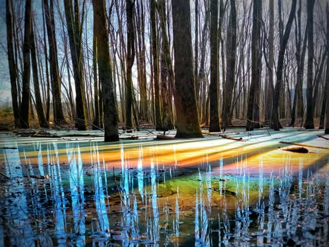
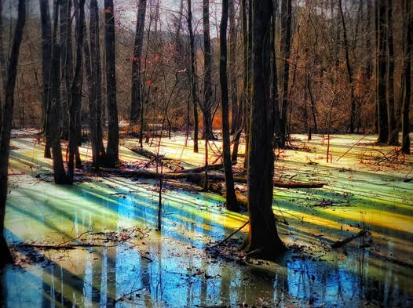
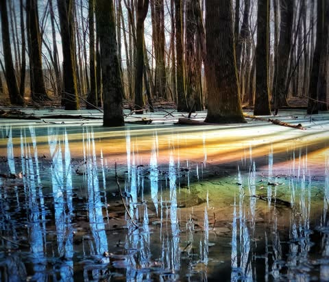

# It's the beginning of unicorn fishing season at bonadea.  During the winter the 

It's the beginning of unicorn fishing season at bonadea.  During the winter the dead logs in the swamp decay and release oils.  When it warms up the oils will be eaten by bacteria, but until then they make rainbows in the swamp.

Go around sunset and walk to the left (clockwise) on a clear sunny day.  Take the longest route, there are several places with standing water where you can see this.  You need to be looking into the sun by about 30 degrees. If you put the phone close to the ground the effect is amplified.  A zoom lens is helpful,  but a phone will probably work.

