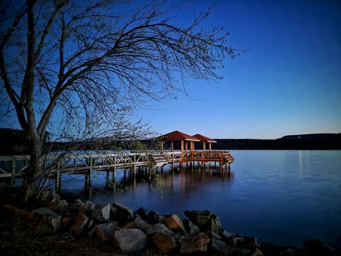
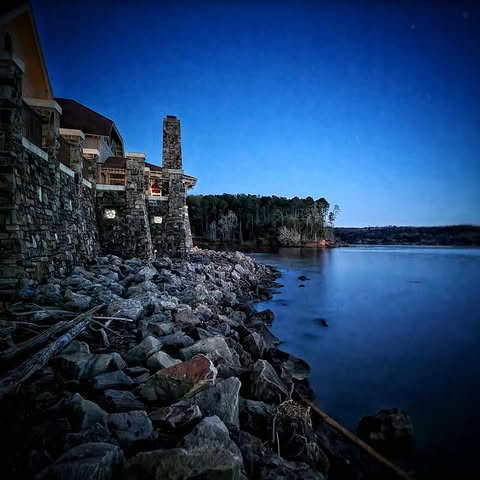
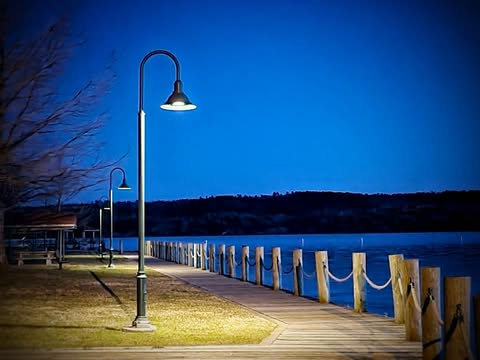
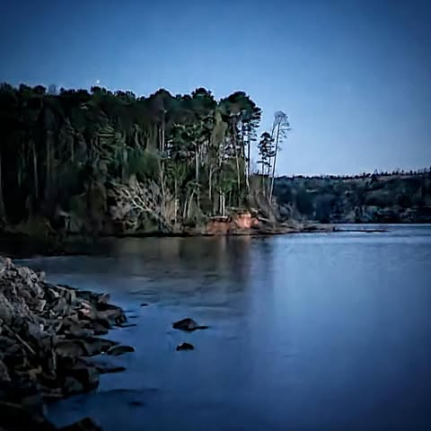

# It was a beautiful evening at the Russellville marina.  The weather was flawless

It was a beautiful evening at the Russellville marina.  The weather was flawless.  The sounds of insects are just beginning, still quiet among the waves.  The trees are flowering, the leaves just starting to bud.  

Soon it will be noisy with boats and cars.  Summer has its own cadence.

But don't miss these spring evenings, they will be gone soon.

