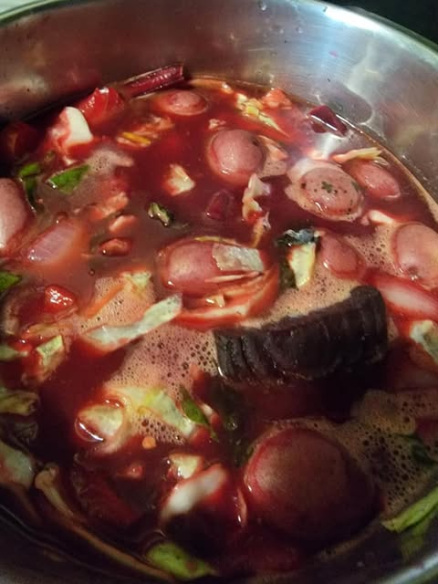
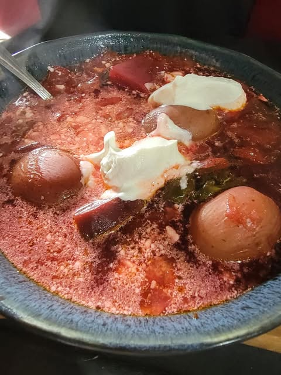

# Beets are apparently one of the healthiest foods on the planet.   But I hated th

Beets are apparently one of the healthiest foods on the planet.   But I hated them for the longest time.   I made myself put them in smoothies though because I could actually  feel the difference.   Kind of like coffee without the jitters.

Over time I got to where I hated them less.  

Today I tried making borscht.   I figured millions of Russians can't be all wrong.

Turns out with a little sour cream it is pretty spectacular. 

Basically chicken broth, beets, small red  potatoes, red bell pepper, cabbage onion and garlic.   Season with pepper and a bunch of dill.  Add a blob of sour cream on top.  

Its different than anything I have ever tried before.

