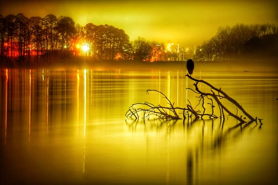

# Imagine if what it already is, was what you wanted it most to be.   Not that it 

Imagine if what it already is, was what you wanted it most to be.   Not that it was made so by desperate action, but that it always was and always would be.

The satisfaction of existing where nothing is flawed.  That you could just observe, without demanding it be somehow different.

Imagine seeing a thing and knowing that it, whatever it was, is the absolute perfection of itself.  Not requiring one thing to be another, not stressing over making it so.  Not regretting that it wasn't. 

As matter and relations melt and flow with time Imagine not resenting that they aren't what they once were, or will eventually become. 

In such a world what place would there be for anger, hatred, resentment, frustration, jealousy.  

Would such a creature be recognizable as man...that being which alone exalts himself by the magnitude of his own imagined misery.  That having been given much, despised it because it wasn't more and so lost it all.

*Location: Lake Dardanelle*

