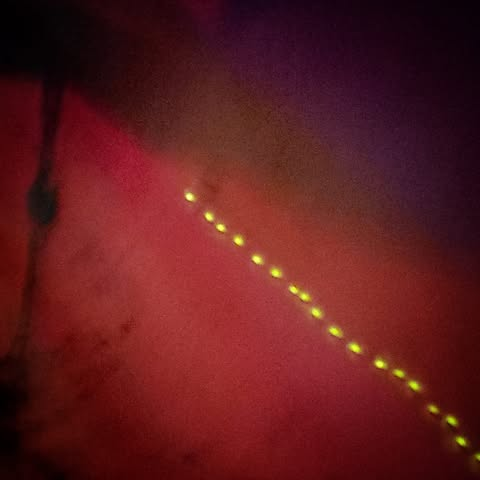

# There is a firefly tonight that somehow ended up in my house.   It seems to have

There is a firefly tonight that somehow ended up in my house.   It seems to have fallen in love with a flickering electric light on my power strip.  It walks in circles blazing for all its worth.   No doubt wondering why the light doesn't respond. 

A firefly only lasts a couple weeks.  In human terms this night will stretch on for years.  It will walk in the dark calling out to a light that will never, can never answer.  I wanted to tell it to move on, "don't waste this short life screaming in vain."   In fact I did tell it, but... you know... it's a firefly.  If it understood this would be a different type of story.

A firefly lives in the moment.   It lacks the reassurance of the past, that this will pass and life will go on.  It lacks the imagination to picture the future.  Other lights in future nights.  It's world is consumed by the present failure, and it's suffering is infinite.  I should have squashed it... it would have been a kindness.

Now it's morning, the firefly is probably around here somewhere having exhausted it's little light.  The power strip flickers in the dark still, oblivious to this small drama it's caused.  I would tell it to be kinder to fireflies.  But...you know... it's a power strip.  If it understood me this would be a different kind of story.

*Location: Dover, Arkansas*

