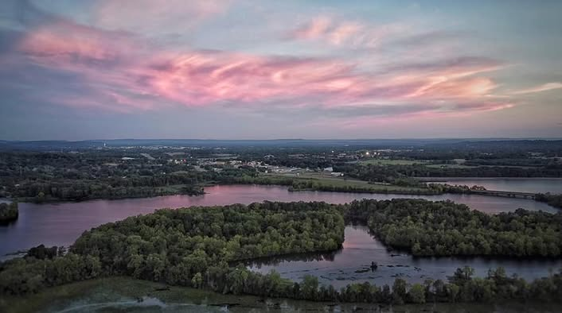
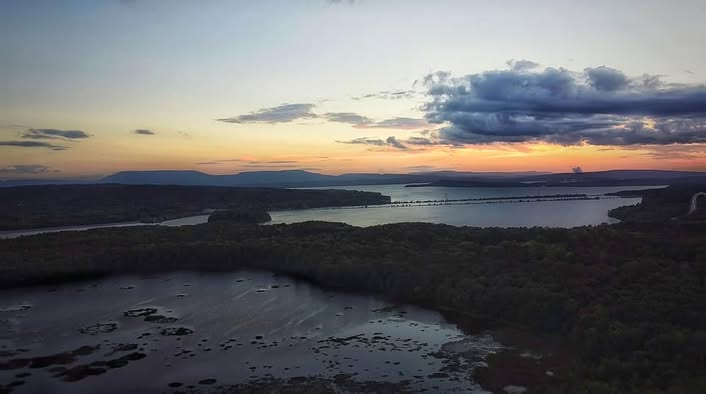
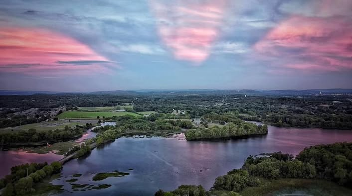
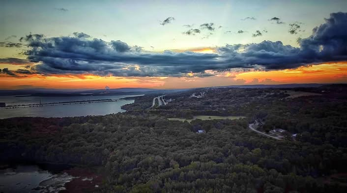
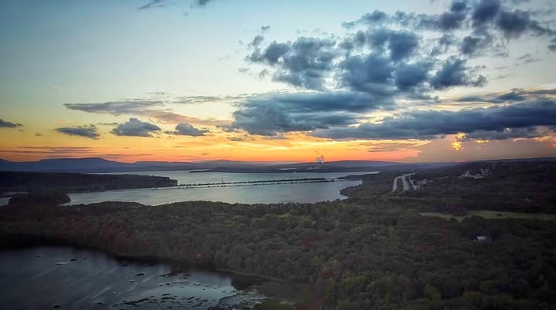

# More of Russellville from Illinois Bayou Trail.  I used a different method to ed

More of Russellville from Illinois Bayou Trail.  I used a different method to edit these.  For those interested:  I shot these using a cheap drone.  The problem with a cheap drone is that it wobbles,  has poor low light performance and a small dynamic range. 

So I tried cleaning them up in software first, but that caused a lot of detail to be lost.  Then I tried exposure stacking 10 stills, which worked pretty well, but there was a lot of movement over 60 seconds so moving subjects (trees) were blurry.  Then I tried HDR stacking with 10 exposures.  This ended up being no better than exposure stacking.

This batch was exposure stacked from 50 frames of video.  Basically export the video to individual frames, align each one, and exposure stack.  The movement was minimal over less than a couple seconds of video, but the resolution was a bit lower.

It's the simplest of the above methods and produces the most realistic results.  The final product has no grain and a decent dynamic range so it can be edited to bring out the color and detail a bit.

