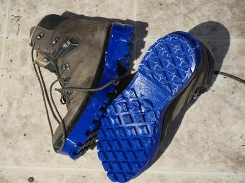
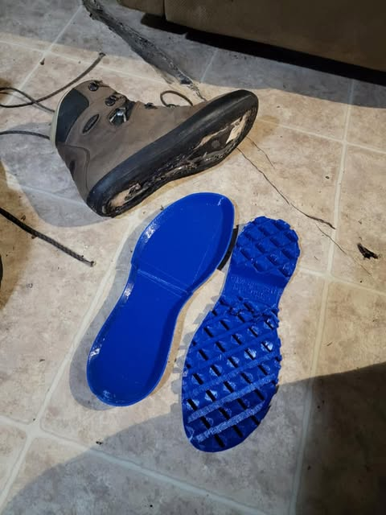
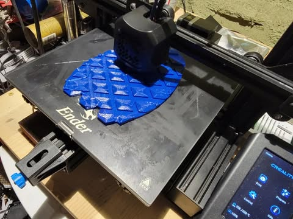

# After 7 years of trying, I finally was able to repair my old hiking boots from t

After 7 years of trying, I finally was able to repair my old hiking boots from the Appalachian Trail by printing new soles.  3d printers are pretty incredible and TPU is an amazing material.  

These were originally $400 Lowa hiking boots, after three years of use the leather was still in perfect condition but the rubber between the soles and the leather turned into some kind of rotten powder.  Not sure why..  maybe I stepped in something.

Kind of wish they were not bright blue... But it is what I happened to have.

The cost of the materials was about $10.  I'm gonna make these last the rest of my life.

