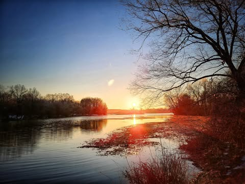

# A traversal.

A traversal.

Delusion dissipates. I arise.  I consume.  I stare into walls.  The distillation of life dries forgotten on cold stones.  An insect feels the earth tremble and runs terrified towards the nearest darkness.  

I gather small lights, directing their destiny.  Binding them to their predestined roles, I cast them far away.  They tell stories, they tell lies and are forgotten.  

I cast judgment on ghosts that never lived, capture the dying light reflecting from drifting clouds.  Then descend to be lost in delusion again and again.

*Location: Russellville, Arkansas*

