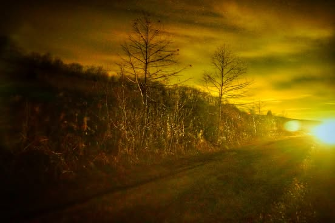

# Smarnak scowled at the vessel encasing the radiant kibble.  It trembled not, des

Smarnak scowled at the vessel encasing the radiant kibble.  It trembled not, despite his latent wrath.  

It lay in the path long traveled... awaiting its time.  And so Smarnak also waited.  As the time passed he pondered how destiny had brought him here to behold this kibble's final performance.  

Behind him the road stretched across continents, to Smarnak's youth.  Before he began this traversal.  In those days it had meaning, power, glory.

So long ago...  Was it truly destiny or merely the foolish arrogance of youth.

Rage.  Does it matter?  The road stretched onward before him.  As the kibble lost its radiance it would impede Smarnak no longer.  

They would become one, these ancient tired bones would animate again.  Smarnak would forever be not where he was.  Trapped in time, denied in space.

He wondered if there was an end... would he fail in this ritual before reaching it?  Would he find himself where he began?  Would the radiance  he carried grow cold and dark?

Smarnak trembled... the kibble was still.

