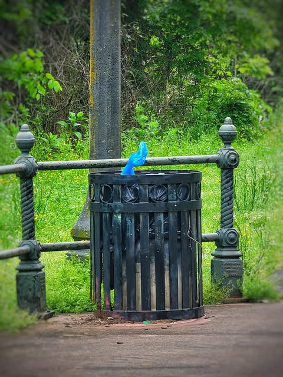

# Today as I walked to work, I spotted in the distance a bird that I thought an un

Today as I walked to work, I spotted in the distance a bird that I thought an unusually vibrant shade of blue.  As I approached I realized it was a plastic bag someone had used to clean up after their dog.

Surely there is a parable here that illuminates the nature of our life on this earth.  I will leave that part to the reader, but I departed a little wiser I think.

*Location: Rebsamen Park*

