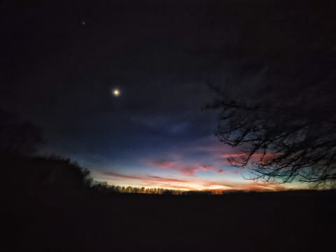

# It's a mistake to believe we saw the world as it was.  We only saw what we looke

It's a mistake to believe we saw the world as it was.  We only saw what we looked at.

*Location: Illinois Bayou Park*

