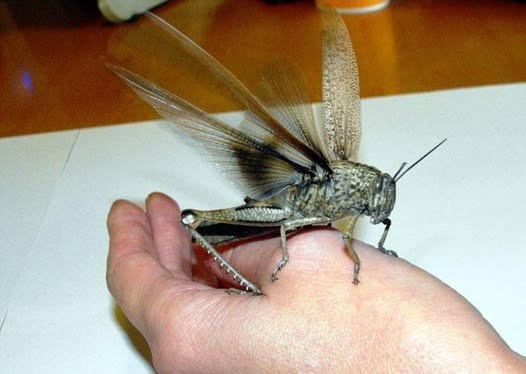

# I thought I had already posted this... But apparently not.  Therefore....

I thought I had already posted this... But apparently not.  Therefore....

I have been unfortunate enough to have eaten a lot of pretty disgusting stuff in my life, looking back I have had to drink two large cups of cow urine, a mug full of cow blood dipped from it’s carcass filled with congealing lumps. A chunk of meat that was still twitching from that same cow (on a dare). Something that I am guessing was sea slug… at least I hope it was sea slug. Hotdogs… well you get the picture.

Thought I would tell the story of another one here.

I went to a boarding school in Kenya in the mid 80’s (Rift Valley Academy). We had no tv’s, computers, internet, cell phones. Heck, we did not even have out own bedrooms… we had to share with 3–5 other kids. This was sometime around 9th grade. As you may imagine, being a bunch of bored teenage boys we were constantly trying to figure out ways to entertain ourselves.  The result was a bunch of often alarmingly stupid dares. 

This seems somewhat cruel in retrospect… but that never even entered our minds at the time. Make of that what you will about the virtue of old British style boarding schools..

There were these giant grasshoppers that lived around the school. I think they got up to about six inches long. They flew around and had giant spikes on the back of their legs, and they could bite. To catch them you had to grab them before they could “re-cock” their legs after they landed. This took a few seconds, and if you could grab them by the legs they could not kick you or bite you (which often drew blood).

So some genius was looking at one of these beasts and a 220 outlet and inspiration struck. A 220 outlet has three prongs, two live and one ground. It also has a on/off switch on the outlet. The center plug is the ground and you have to poke something in it to open a latch on the two live plugs. Convenient....

They discovered that a pen cap would open the latch nicely. So the next step was to turn off the plug, open the latch with a pen cap then insert the grasshoppers back legs into the live holes and remove the cap which would lower the safety thereby holding the grasshopper in place. Then in the name of science they would flip the plug on to see what would happen.

Surprisingly it almost never killed the grasshopper, but it would kick so hard that it’s back legs came off.

Now a grasshopper that has just been subjected to 220 volts from behind wants nothing more than to crawl into a dark hole. So our 8th grade rite of passage was to put the grasshopper on our tongue at which point it would scurry directly down our throat like a self-propelled burrito.

There was a taste… we sometimes cooked and ate these things as well. But the texture of the four front legs scrambling down our throat was the most off-putting. Those that could do it without vomiting in the process could proudly move on to the other asinine semi-psychotic things we were into in those days.

