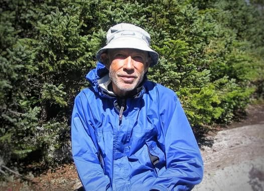

# The Story of Turtle Don.

The Story of Turtle Don.

She asked if hiking the Appalachian Trail was difficult.  I wondered if she was joking.  A 2200 mile march of snow and oppressive heat, hunger, thirst, exhaustion biting insects and pain.  I remembered blistered feet, black from subcutaneous bleeding, toenails falling off tangled in crusty socks. Open sores from backpack straps chaffing shoulders, chaffing everywhere.  

Incredulously I was about to say as much.  Of course it was hard ...  but then I thought of Turtle Don and understood the lie I was about tell.  It's more complicated than that.  Some truths are only revealed on the other side of self imposed agony.

Turtle Don was an old man when I met him. He was walking so slowly that when we passed we were sure he would never make it. He took tiny steps, heel to toe.  We could have gone faster on our knees.  He greeted us cheerfully and assured us with a smile that he was fine and needed nothing, so having done our social minimum we continued on.  After all, we had to hurry to reach the nowhere we were heading for.

The  next day we passed him again. Then again the next…. Each time he smiled and greeted us before we passed him by.  But it was a mystery how he kept getting ahead of us. He had Alzheimer's and was not overly fond of words, so it took some effort figure out. 

We (everyone else) would walk until about an hour before dark, then stop at the first shelter, eat dinner, rest a bit, sleep until 8 am or so and continue on. Turns out Turtle Don would walk until it got dark, then he would keep walking in the dark, then eventually he would collapse in the middle of the trail.  Amid the hard earth and broken stones he would pull a blanket over himself.  Long before the sun rose he would be up shuffling slowly onward. 

It did not matter if it was raining, snowing or hot he just kept creeping along.  After having covered only a third of the trail his legs started retaining fluid and swole to triple their usual size. His wife came and took him to the hospital. We thought that was the last we would see of Turtle Don.

It made sense, that is the way things are after all.  Those that try to fly too high fall hard.  Although we admired his courage, life has a way of humbling our ambitions.

Four months pass and we are stumbling exhausted through the Mahoosuc Notch, probably the most difficult section of the trail.  And inexplicably, creeping along, there is Turtle Don. He is covered in cuts, skinned up by the rocks, his glasses are broken, a trickle of dried blood runs from a lump on his head. As always, he was grinning from ear to ear and greeted us cheerfully for the last time.  He could not remember any of us but that was no longer relevant. 

He had left the hospital and skipped ahead so he could get to the end point before the park closed on Oct 15. Then he would go back and do the section he skipped. We spoke with his wife, she said he did not have long to live but was determined to finish.  The AT was something he always wanted to do, but it was just recently that the responsibilities of life had released their hold.

Had we asked him, I don’t think he would have said it was difficult… it was what he wanted to do and he was loving it.

So we sat with him for a while and said nothing as we enjoyed the breeze.  I knew that when Turtle Don passed through that last door it would be the one of his own choosing and he would do so joyfully. Legends are born from those humble souls that hold onto a treasure for which they are prepared to sacrifice all else.  

For the rest of us, timidly marveling at what appears superhuman resolve, it may seem a madness has overtaken them.  We don't know how they resist being washed along as we are in the currents of fate and circumstance.   Why they don't cry and moan, where do they find the strength?  Perhaps they are just ignorant of the fearful fate that awaits.

But perhaps they found a reason to joyfully pay the ferryman what he demands at the  passage. 

It seems that is the way of life, though it may cost you everything, nothing done of love is difficult.

Turtle Don - New Hampshire 2004

…

